# LAPORAN MODUL 1 – UNIT 1.1
## Persiapan Source Layer dan Initial Data Profiling

**Studi Kasus:** Database Akademik Perguruan Tinggi  
**DBMS:** PostgreSQL  
**Schema:** `src`

---

## Identitas Laporan

| Identitas | Keterangan |
|---|---|
| Nama | ........................................................ |
| NIM | ........................................................ |
| Program Studi | ........................................................ |
| Kelas/Kelompok | ........................................................ |
| Modul | 1 |
| Unit | 1.1 |
| Tanggal Praktikum | ........................................................ |
| Dosen/Instruktur | ........................................................ |

## Tujuan Praktikum

Praktikum Unit 1.1 bertujuan menyiapkan source layer pada PostgreSQL, memuat dataset raw UADW v1.0, memverifikasi struktur dan jumlah data sumber, serta melakukan *initial profiling* untuk memperoleh gambaran awal karakteristik dataset akademik.

## Ketentuan Praktikum

1. Menggunakan PostgreSQL dan schema `src`.
2. Mempertahankan nilai raw sebagaimana tersedia pada file sumber.
3. Tidak melakukan cleaning, standardisasi, deduplikasi, `UPDATE`, atau `DELETE` terhadap isi raw source pada unit ini.
4. Menyesuaikan path file CSV dengan lokasi dataset pada komputer masing-masing.
5. Menyertakan query, hasil eksekusi, dan interpretasi.
6. Mencatat perbedaan hasil aktual dengan nilai acuan tanpa mengubah data agar sesuai acuan.

---

## 1. Verifikasi Environment PostgreSQL

### 1.1 Memeriksa versi PostgreSQL

**Query SQL:**
```sql
SELECT version();
```

**Hasil eksekusi:**

```text
[Isi dengan hasil SELECT version() dari PostgreSQL]
```

**Interpretasi:** Versi PostgreSQL belum dapat diketahui dari teks kode karena query hanya menampilkan versi ketika dijalankan. Hasil eksekusi perlu ditempelkan pada bagian ini.

### 1.2 Memeriksa database dan user aktif

**Query SQL:**
```sql
SELECT
    current_database() AS database_aktif,
    current_user AS user_aktif;
```

**Hasil eksekusi:**

| database_aktif | user_aktif |
|---|---|
| Belum tersedia | Belum tersedia |

**Interpretasi:** Query ini digunakan untuk mengetahui database yang sedang aktif dan user PostgreSQL yang digunakan. Nama database dan user tidak tampak pada screenshot yang diberikan, sehingga perlu diisi berdasarkan hasil eksekusi lokal.

### 1.3 Memeriksa keberadaan schema `src`

**Query SQL:**
```sql
SELECT schema_name
FROM information_schema.schemata
WHERE schema_name = 'src';
```

**Hasil eksekusi:**

| schema_name |
|---|
| `src` (didefinisikan melalui DDL; hasil query verifikasi belum dilampirkan) |

**Status:** Schema `src` dibuat oleh perintah `CREATE SCHEMA IF NOT EXISTS src;`. Hasil query verifikasi langsung tetap perlu dilampirkan.

**Interpretasi:** Perintah `CREATE SCHEMA IF NOT EXISTS` membuat schema `src` apabila belum tersedia dan tidak menghasilkan error jika schema tersebut sudah ada.

---

## 2. Membuat dan Memverifikasi Source Layer

Source layer menggunakan schema `src` untuk menyimpan data mentah (*raw source*). DDL yang digunakan pada kode adalah sebagai berikut.

### 2.1 Membuat schema dan sepuluh tabel sumber

**Script DDL yang digunakan:**

```sql
-- MODUL 1 - UNIT 1.1
-- B. MEMBUAT SOURCE LAYER

CREATE SCHEMA IF NOT EXISTS src;

CREATE TABLE IF NOT EXISTS src.program_studi (
    kode_prodi TEXT,
    nama_prodi TEXT,
    fakultas TEXT,
    departemen TEXT,
    status TEXT
);

CREATE TABLE IF NOT EXISTS src.semester (
    semester_id TEXT,
    tahun_akademik TEXT,
    term TEXT,
    urutan_tahun INTEGER,
    tanggal_mulai TEXT,
    tanggal_selesai TEXT
);

CREATE TABLE IF NOT EXISTS src.mahasiswa (
    nim TEXT,
    nama TEXT,
    jk_raw TEXT,
    tanggal_lahir_raw TEXT,
    kota_asal_raw TEXT,
    kode_prodi_raw TEXT,
    prodi_raw TEXT,
    angkatan TEXT,
    tanggal_masuk_raw TEXT,
    status_raw TEXT,
    email_kampus TEXT
);

CREATE TABLE IF NOT EXISTS src.dosen (
    nidn TEXT,
    nama_dosen TEXT,
    jk_raw TEXT,
    unit_prodi_raw TEXT,
    jabatan_akademik TEXT,
    tanggal_masuk_raw TEXT,
    status TEXT
);

CREATE TABLE IF NOT EXISTS src.mata_kuliah (
    kode_mk TEXT,
    nama_mk TEXT,
    kode_prodi TEXT,
    sks INTEGER,
    semester_rekomendasi INTEGER,
    kategori TEXT,
    aktif TEXT
);

CREATE TABLE IF NOT EXISTS src.krs (
    krs_id TEXT,
    nim TEXT,
    kode_mk TEXT,
    semester_id TEXT,
    kelas TEXT,
    status_krs TEXT,
    tanggal_ambil_raw TEXT,
    sumber_sistem TEXT
);

CREATE TABLE IF NOT EXISTS src.nilai (
    nilai_id TEXT,
    nim TEXT,
    kode_mk TEXT,
    semester_id TEXT,
    nilai_angka NUMERIC(6,2),
    nilai_huruf TEXT,
    status_lulus TEXT,
    tanggal_input_raw TEXT
);

CREATE TABLE IF NOT EXISTS src.aktivitas_lms (
    lms_event_id TEXT,
    nim TEXT,
    kode_mk TEXT,
    semester_id TEXT,
    waktu_event TEXT,
    tipe_event TEXT,
    durasi_menit INTEGER,
    skor_kuis NUMERIC(6,2),
    platform TEXT
);

CREATE TABLE IF NOT EXISTS src.pembayaran (
    pembayaran_id TEXT,
    nim TEXT,
    semester_id TEXT,
    tanggal_bayar_raw TEXT,
    nominal_tagihan BIGINT,
    nominal_bayar BIGINT,
    status_pembayaran TEXT,
    kanal TEXT
);

CREATE TABLE IF NOT EXISTS src.kelulusan (
    kelulusan_id TEXT,
    nim TEXT,
    tanggal_lulus_raw TEXT,
    ipk_final NUMERIC(4,2),
    masa_studi_bulan INTEGER,
    predikat TEXT,
    status_tepat_waktu TEXT
);
```

**Daftar sepuluh tabel yang dibuat berdasarkan DDL:**

| No. | Nama tabel | Jumlah kolom |
|---:|---|---:|
| 1 | `src.program_studi` | 5 |
| 2 | `src.semester` | 6 |
| 3 | `src.mahasiswa` | 11 |
| 4 | `src.dosen` | 7 |
| 5 | `src.mata_kuliah` | 7 |
| 6 | `src.krs` | 8 |
| 7 | `src.nilai` | 8 |
| 8 | `src.aktivitas_lms` | 9 |
| 9 | `src.pembayaran` | 8 |
| 10 | `src.kelulusan` | 7 |

**Bukti struktur kolom mahasiswa:**

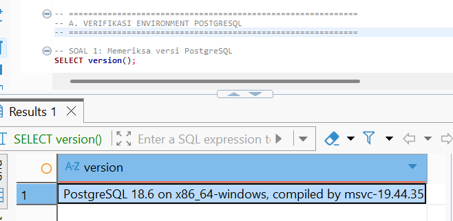

*Keterangan: Screenshot struktur kolom tabel mahasiswa pada database.*

**Interpretasi:** DDL membuat satu schema `src` dan sepuluh tabel sumber. Tabel-tabel tersebut terdiri atas tabel master/reference dan tabel transaksi/aktivitas. Perlu diperhatikan bahwa DDL yang dikirim mendefinisikan kolom `angkatan` sebagai `TEXT`, sedangkan screenshot struktur database memperlihatkan `angkatan` bertipe `integer`. Perbedaan ini dibahas kembali pada Bagian 8 dan perlu diselaraskan sebelum laporan dikumpulkan.

---

## 3. Mengimpor/Mengakses Raw Source

Dataset UADW v1.0 terdiri atas sepuluh file CSV. Nilai raw dipertahankan pada source layer dan belum dilakukan cleaning atau standardisasi.

### 3.1 Perintah impor CSV

**Catatan kesesuaian kode:** Pada script yang dikirim, bagian Soal 5 berisi query `COUNT(*)` untuk memeriksa jumlah baris, bukan perintah impor file CSV. Perintah `\copy` berikut merupakan langkah impor tambahan yang perlu dijalankan sebelum pemeriksaan jumlah baris.

Sesuaikan `/PATH/UADW_v1.0/` dengan lokasi dataset pada komputer masing-masing. Jalankan perintah ini melalui terminal `psql`.

```sql
\copy src.program_studi FROM '/PATH/UADW_v1.0/01_raw_data/program_studi.csv' CSV HEADER ENCODING 'UTF8';
\copy src.semester      FROM '/PATH/UADW_v1.0/01_raw_data/semester.csv'      CSV HEADER ENCODING 'UTF8';
\copy src.mahasiswa     FROM '/PATH/UADW_v1.0/01_raw_data/mahasiswa.csv'     CSV HEADER ENCODING 'UTF8';
\copy src.dosen         FROM '/PATH/UADW_v1.0/01_raw_data/dosen.csv'         CSV HEADER ENCODING 'UTF8';
\copy src.mata_kuliah   FROM '/PATH/UADW_v1.0/01_raw_data/mata_kuliah.csv'   CSV HEADER ENCODING 'UTF8';
\copy src.krs           FROM '/PATH/UADW_v1.0/01_raw_data/krs.csv'           CSV HEADER ENCODING 'UTF8';
\copy src.nilai         FROM '/PATH/UADW_v1.0/01_raw_data/nilai.csv'         CSV HEADER ENCODING 'UTF8';
\copy src.aktivitas_lms FROM '/PATH/UADW_v1.0/01_raw_data/aktivitas_lms.csv' CSV HEADER ENCODING 'UTF8';
\copy src.pembayaran    FROM '/PATH/UADW_v1.0/01_raw_data/pembayaran.csv'    CSV HEADER ENCODING 'UTF8';
\copy src.kelulusan     FROM '/PATH/UADW_v1.0/01_raw_data/kelulusan.csv'     CSV HEADER ENCODING 'UTF8';
```

### 3.2 Catatan proses impor

| No. | File CSV | Tabel tujuan | Status berdasarkan row count | Jumlah baris hasil pemeriksaan | Catatan |
|---:|---|---|---|---:|---|
| 1 | `program_studi.csv` | `src.program_studi` | Data tersedia | 6 | Sesuai acuan |
| 2 | `semester.csv` | `src.semester` | Data tersedia | 8 | Sesuai acuan |
| 3 | `mahasiswa.csv` | `src.mahasiswa` | Data tersedia | 1.965 | Sesuai acuan |
| 4 | `dosen.csv` | `src.dosen` | Data tersedia | 96 | Sesuai acuan |
| 5 | `mata_kuliah.csv` | `src.mata_kuliah` | Data tersedia | 208 | Sesuai acuan |
| 6 | `krs.csv` | `src.krs` | Data tersedia | 57.025 | Sesuai acuan |
| 7 | `nilai.csv` | `src.nilai` | Data tersedia | 57.000 | Sesuai acuan |
| 8 | `aktivitas_lms.csv` | `src.aktivitas_lms` | Data tersedia | 200.356 | Sesuai acuan |
| 9 | `pembayaran.csv` | `src.pembayaran` | Data tersedia | 9.500 | Sesuai acuan |
| 10 | `kelulusan.csv` | `src.kelulusan` | Data tersedia | 347 | Sesuai acuan |

**Bukti hasil pemeriksaan jumlah baris source:**

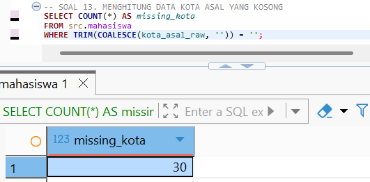

*Keterangan: Hasil query jumlah baris pada sepuluh tabel sumber.*

**Interpretasi:** Hasil pemeriksaan menunjukkan seluruh sepuluh tabel telah berisi data dengan jumlah yang sesuai nilai acuan. Namun, screenshot yang tersedia merupakan hasil query jumlah baris, bukan log langsung proses `\copy`. Oleh karena itu, bukti tersebut memastikan data tersedia di tabel, tetapi tidak memperlihatkan pesan sukses impor untuk setiap file CSV.

---

## 4. Menginventarisasi Tabel pada Schema `src`

**Query SQL:**

```sql
SELECT
    table_schema,
    table_name
FROM information_schema.tables
WHERE table_schema = 'src'
  AND table_type = 'BASE TABLE'
ORDER BY table_name;
```

**Hasil inventarisasi berdasarkan DDL dan tabel yang diperiksa:**

| table_schema | table_name |
|---|---|
| `src` | `aktivitas_lms` |
| `src` | `dosen` |
| `src` | `kelulusan` |
| `src` | `krs` |
| `src` | `mahasiswa` |
| `src` | `mata_kuliah` |
| `src` | `nilai` |
| `src` | `pembayaran` |
| `src` | `program_studi` |
| `src` | `semester` |

**Interpretasi:** Inventarisasi menunjukkan terdapat sepuluh tabel sumber pada schema `src`. Seluruh tabel digunakan untuk menyimpan data awal akademik sebelum dilakukan pengolahan lebih lanjut.

---

## 5. Verifikasi Jumlah Baris Lima Source Awal

Lima tabel master/reference yang diperiksa adalah `program_studi`, `semester`, `mahasiswa`, `dosen`, dan `mata_kuliah`.

**Query SQL:**

```sql
SELECT 'program_studi' AS tabel, COUNT(*) AS jumlah_baris
FROM src.program_studi
UNION ALL
SELECT 'semester', COUNT(*) FROM src.semester
UNION ALL
SELECT 'mahasiswa', COUNT(*) FROM src.mahasiswa
UNION ALL
SELECT 'dosen', COUNT(*) FROM src.dosen
UNION ALL
SELECT 'mata_kuliah', COUNT(*) FROM src.mata_kuliah
ORDER BY tabel;
```

**Hasil eksekusi:**

| tabel | jumlah_baris |
|---|---:|
| `program_studi` | 6 |
| `semester` | 8 |
| `mahasiswa` | 1.965 |
| `dosen` | 96 |
| `mata_kuliah` | 208 |

**Interpretasi:** Kelima tabel master/reference memiliki jumlah baris sesuai nilai acuan dataset, yaitu program studi 6, semester 8, mahasiswa 1.965, dosen 96, dan mata kuliah 208. Tidak terlihat perbedaan jumlah baris pada kelima tabel tersebut.

---

## 6. Verifikasi Jumlah Baris Seluruh Sepuluh Source

**Query SQL:**

```sql
SELECT 'program_studi' AS tabel, COUNT(*) AS jumlah_baris FROM src.program_studi
UNION ALL SELECT 'semester', COUNT(*) FROM src.semester
UNION ALL SELECT 'mahasiswa', COUNT(*) FROM src.mahasiswa
UNION ALL SELECT 'dosen', COUNT(*) FROM src.dosen
UNION ALL SELECT 'mata_kuliah', COUNT(*) FROM src.mata_kuliah
UNION ALL SELECT 'krs', COUNT(*) FROM src.krs
UNION ALL SELECT 'nilai', COUNT(*) FROM src.nilai
UNION ALL SELECT 'aktivitas_lms', COUNT(*) FROM src.aktivitas_lms
UNION ALL SELECT 'pembayaran', COUNT(*) FROM src.pembayaran
UNION ALL SELECT 'kelulusan', COUNT(*) FROM src.kelulusan
ORDER BY tabel;
```

**Hasil eksekusi:**

| Dataset | Jumlah baris aktual | Jumlah baris acuan | Status |
|---|---:|---:|---|
| `program_studi` | 6 | 6 | Sesuai |
| `semester` | 8 | 8 | Sesuai |
| `mahasiswa` | 1.965 | 1.965 | Sesuai |
| `dosen` | 96 | 96 | Sesuai |
| `mata_kuliah` | 208 | 208 | Sesuai |
| `krs` | 57.025 | 57.025 | Sesuai |
| `nilai` | 57.000 | 57.000 | Sesuai |
| `aktivitas_lms` | 200.356 | 200.356 | Sesuai |
| `pembayaran` | 9.500 | 9.500 | Sesuai |
| `kelulusan` | 347 | 347 | Sesuai |

**Interpretasi:** Seluruh sepuluh tabel memiliki jumlah baris sesuai nilai acuan. Tabel `aktivitas_lms` memiliki jumlah baris paling banyak, sedangkan `program_studi` memiliki jumlah paling sedikit. Kesesuaian row count menunjukkan volume data source telah sesuai dengan dataset acuan.

---

## 7. Verifikasi Jumlah Kolom Seluruh Source

**Query SQL:**

```sql
SELECT
    table_name,
    COUNT(*) AS jumlah_kolom
FROM information_schema.columns
WHERE table_schema = 'src'
GROUP BY table_name
ORDER BY table_name;
```

**Hasil berdasarkan definisi DDL:**

| table_name | jumlah_kolom |
|---|---:|
| `aktivitas_lms` | 9 |
| `dosen` | 7 |
| `kelulusan` | 7 |
| `krs` | 8 |
| `mahasiswa` | 11 |
| `mata_kuliah` | 7 |
| `nilai` | 8 |
| `pembayaran` | 8 |
| `program_studi` | 5 |
| `semester` | 6 |

**Interpretasi:** Jumlah kolom dihitung berdasarkan definisi DDL. Tabel `mahasiswa` memiliki 11 kolom, `aktivitas_lms` 9 kolom, tabel `krs`, `nilai`, dan `pembayaran` masing-masing 8 kolom, serta tabel lainnya memiliki 5–7 kolom. Hasil ini menjadi gambaran struktur awal setiap source.

---

## 8. Verifikasi Struktur Kolom Tabel Mahasiswa

**Query SQL:**

```sql
SELECT
    ordinal_position AS posisi_kolom,
    column_name AS nama_kolom,
    data_type AS tipe_data
FROM information_schema.columns
WHERE table_schema = 'src'
  AND table_name = 'mahasiswa'
ORDER BY ordinal_position;
```

**Struktur berdasarkan DDL yang dikirim:**

| posisi_kolom | nama_kolom | tipe_data menurut DDL |
|---:|---|---|
| 1 | `nim` | text |
| 2 | `nama` | text |
| 3 | `jk_raw` | text |
| 4 | `tanggal_lahir_raw` | text |
| 5 | `kota_asal_raw` | text |
| 6 | `kode_prodi_raw` | text |
| 7 | `prodi_raw` | text |
| 8 | `angkatan` | text |
| 9 | `tanggal_masuk_raw` | text |
| 10 | `status_raw` | text |
| 11 | `email_kampus` | text |

**Bukti hasil pemeriksaan database:**


*Keterangan: Hasil pemeriksaan struktur kolom tabel mahasiswa.*

**Interpretasi:** Berdasarkan DDL terakhir yang dikirim, seluruh 11 kolom pada tabel `mahasiswa` bertipe `TEXT`. Namun, screenshot database memperlihatkan kolom `angkatan` bertipe `integer`, sedangkan kolom lainnya terlihat `text`. Dengan demikian, terdapat perbedaan antara DDL yang dikirim dan struktur tabel yang ditampilkan screenshot. Jika laporan harus sama persis dengan kode, definisi `angkatan TEXT` perlu diterapkan pada database. Jika struktur database yang sekarang memang dikehendaki, DDL harus diperbarui agar menggunakan `angkatan INTEGER`.

---

## 9. Verifikasi Candidate Key Mahasiswa

NIM merupakan *candidate natural key* secara bisnis untuk mengidentifikasi mahasiswa. Keunikan NIM perlu diperiksa sebelum digunakan sebagai key.

**Query SQL:**

```sql
SELECT
    COUNT(*) AS jumlah_seluruh_baris,
    COUNT(DISTINCT nim) AS jumlah_nim_berbeda,
    COUNT(*) - COUNT(DISTINCT nim) AS indikasi_baris_berlebih
FROM src.mahasiswa;
```

**Hasil eksekusi:**

| jumlah_seluruh_baris | jumlah_nim_berbeda | indikasi_baris_berlebih |
|---:|---:|---:|
| 1.965 | 1.950 | 15 |

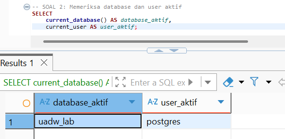

*Keterangan: Hasil penghitungan jumlah seluruh baris, NIM berbeda, dan selisihnya.*

**Analisis:**

- Apakah jumlah seluruh baris sama dengan jumlah NIM unik? **Tidak.** Jumlah seluruh baris adalah 1.965, sedangkan jumlah NIM berbeda adalah 1.950.
- Apakah terdapat indikasi NIM duplikat? **Terdapat indikasi selisih sebanyak 15 baris.**
- Apakah hasil ini cukup untuk memutuskan penghapusan record? **Belum.** Perlu pemeriksaan NIM yang berulang dan isi record untuk mengetahui apakah benar terjadi duplikasi atau terdapat data historis.

**Interpretasi:** Selisih 15 menunjukkan bahwa jumlah baris lebih banyak daripada jumlah NIM berbeda. Hal ini menjadi indikasi adanya NIM yang berulang. Namun, hasil ini belum membuktikan bahwa seluruh 15 baris merupakan duplikasi yang harus dihapus. Pemeriksaan lanjutan diperlukan dan raw source harus tetap dipertahankan pada unit ini.

---

## 10. Mengetahui Rentang Angkatan Mahasiswa

**Query SQL:**

```sql
SELECT
    MIN(CAST(angkatan AS INTEGER)) AS angkatan_min,
    MAX(CAST(angkatan AS INTEGER)) AS angkatan_max
FROM src.mahasiswa;
```

**Hasil eksekusi:**

| angkatan_min | angkatan_max |
|---:|---:|
| 2021 | 2024 |

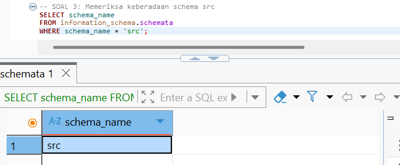

*Keterangan: Hasil rentang tahun angkatan mahasiswa.*

**Interpretasi:** Rentang angkatan mahasiswa pada dataset dimulai dari tahun 2021 sampai dengan tahun 2024. Artinya, data mencakup mahasiswa dari empat tahun angkatan tersebut.

---

## 11. Memeriksa Data Kota Asal yang Kosong

**Query SQL:**

```sql
SELECT COUNT(*) AS missing_kota
FROM src.mahasiswa
WHERE TRIM(COALESCE(kota_asal_raw, '')) = '';
```

**Hasil eksekusi:**

| missing_kota |
|---:|
| 30 |

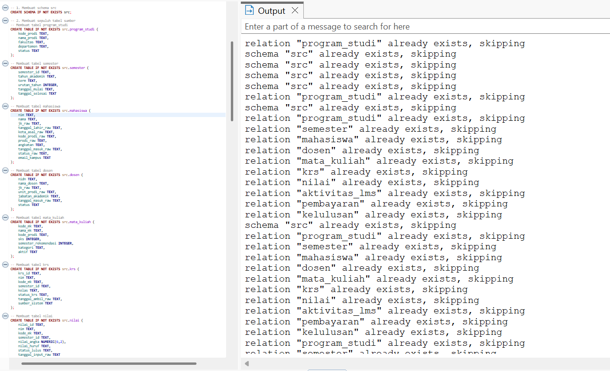

*Keterangan: Hasil penghitungan data kota asal yang kosong.*

**Interpretasi:** Terdapat 30 record mahasiswa yang memiliki nilai kota asal kosong atau hanya berisi spasi. Data kosong ini dapat mengurangi kelengkapan analisis persebaran daerah asal mahasiswa. Penanganan missing value dapat dilakukan pada tahap berikutnya tanpa mengubah raw source pada unit ini.

---

## 12. Menghitung Variasi Label Program Studi pada Mahasiswa

**Query SQL:**

```sql
SELECT COUNT(DISTINCT prodi_raw) AS distinct_prodi_raw
FROM src.mahasiswa;
```

**Hasil eksekusi:**

| distinct_prodi_raw |
|---:|
| 30 |

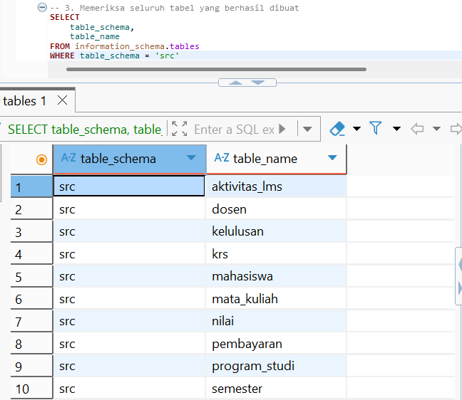

*Keterangan: Hasil penghitungan variasi label program studi pada mahasiswa.*

**Interpretasi:** Terdapat 30 variasi nilai pada kolom `prodi_raw`. Jumlah tersebut menunjukkan bahwa label program studi pada data mahasiswa memiliki berbagai bentuk penulisan, singkatan, atau variasi kapitalisasi.

---

## 13. Menghitung Jumlah Program Studi pada Tabel Referensi

**Query SQL:**

```sql
SELECT COUNT(*) AS canonical_programs
FROM src.program_studi;
```

**Hasil eksekusi:**

| canonical_programs |
|---:|
| 6 |

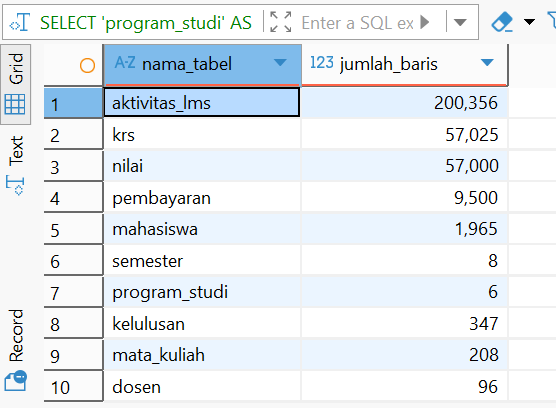

*Keterangan: Hasil penghitungan record pada tabel referensi program studi.*

**Perbandingan:**

| Keterangan | Jumlah |
|---|---:|
| Variasi label `prodi_raw` | 30 |
| Record pada `src.program_studi` | 6 |

**Interpretasi:** Terdapat 30 variasi label pada data mahasiswa, sedangkan tabel referensi hanya memiliki 6 record program studi. Jumlah label mentah yang lebih banyak menunjukkan adanya variasi representasi nama program studi. Label tersebut perlu dipetakan ke nilai referensi pada tahap standardisasi berikutnya.

---

## 14. Menampilkan Distribusi Label Program Studi Mentah

**Query SQL:**

```sql
SELECT
    prodi_raw,
    COUNT(*) AS jumlah
FROM src.mahasiswa
GROUP BY prodi_raw
ORDER BY prodi_raw;
```

**Hasil eksekusi berdasarkan 30 baris yang terlihat pada screenshot:**

| prodi_raw | jumlah |
|---|---:|
| `BD` | 21 |
| `Bisnis Dig.` | 18 |
| `Bisnis digital` | 15 |
| `Bisnis Digital` | 229 |
| `BISNIS DIGITAL` | 12 |
| `Data Science` | 8 |
| `DS` | 25 |
| `IF` | 34 |
| `informatika` | 20 |
| `Informatika` | 276 |
| `INFORMATIKA` | 16 |
| `Sains data` | 15 |
| `Sains Data` | 234 |
| `SAINS DATA` | 11 |
| `SI` | 17 |
| `Sist. Informasi` | 17 |
| `Sistem informasi` | 19 |
| `Sistem Informasi` | 281 |
| `SISTEM INFORMASI` | 18 |
| `Tek. Informasi` | 25 |
| `Tek. Rekayasa Komput…` | 16 |
| `Teknik Informatika` | 25 |
| `Teknologi Informasi` | 13 |
| `Teknologi Informasi` | 286 |
| `TEKNOLOGI INFORMA…` | 24 |
| `Teknologi Rekayasa Ko…` | 224 |
| `TEKNOLOGI REKAYASA…` | 12 |
| `TI` | 25 |
| `TR` | 13 |
| `TRK` | 16 |

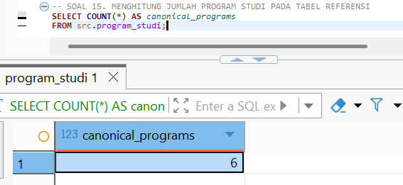

*Keterangan: Tampilan hasil distribusi label program studi baris 1–10.*


*Keterangan: Tampilan hasil distribusi label program studi baris 11–20.*


*Keterangan: Tampilan hasil distribusi label program studi baris 21–30.*

**Interpretasi:** Berdasarkan angka yang terlihat, label dengan jumlah terbesar adalah `Teknologi Informasi` sebanyak 286, disusul `Sistem Informasi` sebanyak 281 dan `Informatika` sebanyak 276. Terlihat variasi kapitalisasi, singkatan, dan penulisan, misalnya `Informatika`, `INFORMATIKA`, `informatika`, serta `SI`, `Sist. Informasi`, dan `Sistem Informasi`. Sebagian teks label pada screenshot terpotong oleh lebar kolom, sehingga nama lengkap perlu diperiksa langsung dari hasil query PostgreSQL.

---

## 15. Menampilkan Variasi Label Jenis Kelamin

**Query SQL:**

```sql
SELECT
    jk_raw,
    COUNT(*) AS jumlah
FROM src.mahasiswa
GROUP BY jk_raw
ORDER BY jk_raw;
```

**Hasil eksekusi:**

| jk_raw | jumlah |
|---|---:|
| `F` | 39 |
| `L` | 764 |
| `Laki-laki` | 162 |
| `M` | 53 |
| `P` | 764 |
| `Perempuan` | 183 |

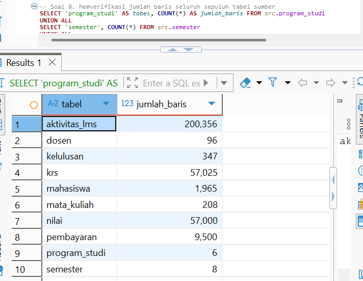

*Keterangan: Hasil distribusi nilai pada kolom `jk_raw`.*

**Interpretasi:** Ditemukan enam variasi label jenis kelamin, yaitu `F`, `L`, `Laki-laki`, `M`, `P`, dan `Perempuan`. Hal ini menunjukkan representasi jenis kelamin belum seragam karena menggunakan singkatan dan istilah teks. Standardisasi label dapat dilakukan pada tahap berikutnya dengan tetap mempertahankan nilai asli pada source layer.

---

## 16. Menampilkan Sampel Record Tabel Mahasiswa

**Query SQL:**

```sql
SELECT *
FROM src.mahasiswa
LIMIT 5;
```

**Hasil eksekusi:**

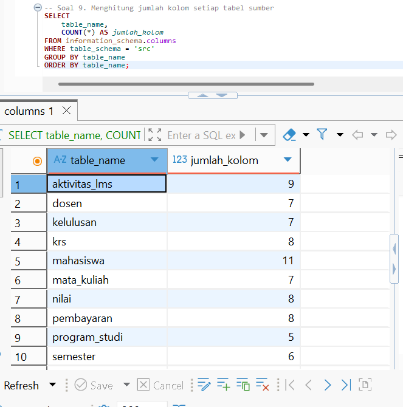

*Keterangan: Sampel record mahasiswa yang menampilkan NIM, nama, dan jenis kelamin.*


*Keterangan: Sampel record mahasiswa yang menampilkan tanggal lahir, kota asal, dan kode program studi.*


*Keterangan: Sampel record mahasiswa yang menampilkan label program studi, angkatan, dan tanggal masuk.*

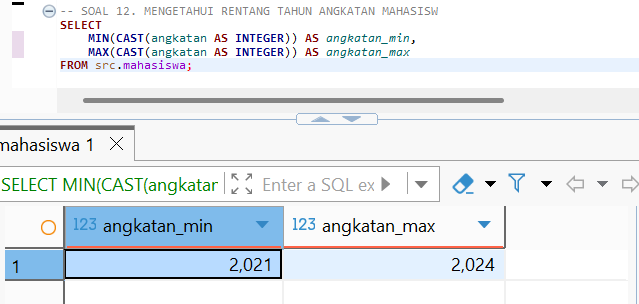

*Keterangan: Sampel record mahasiswa yang menampilkan status dan email kampus.*

**Interpretasi:** Sampel memperlihatkan atribut identitas mahasiswa, jenis kelamin, tanggal lahir, kota asal, kode dan nama program studi, angkatan, tanggal masuk, status, serta email kampus. Terlihat bahwa beberapa atribut disimpan sebagai data raw. Lima record belum cukup untuk menyimpulkan kualitas seluruh dataset karena jumlah tersebut hanya sebagian kecil dari total 1.965 record.

---

## 17. Mengidentifikasi Source dengan Jumlah Baris Terbesar

**Query SQL:**

```sql
SELECT 'program_studi' AS source, COUNT(*) AS rows FROM src.program_studi
UNION ALL SELECT 'semester', COUNT(*) FROM src.semester
UNION ALL SELECT 'mahasiswa', COUNT(*) FROM src.mahasiswa
UNION ALL SELECT 'dosen', COUNT(*) FROM src.dosen
UNION ALL SELECT 'mata_kuliah', COUNT(*) FROM src.mata_kuliah
UNION ALL SELECT 'krs', COUNT(*) FROM src.krs
UNION ALL SELECT 'nilai', COUNT(*) FROM src.nilai
UNION ALL SELECT 'aktivitas_lms', COUNT(*) FROM src.aktivitas_lms
UNION ALL SELECT 'pembayaran', COUNT(*) FROM src.pembayaran
UNION ALL SELECT 'kelulusan', COUNT(*) FROM src.kelulusan
ORDER BY rows DESC;
```

**Hasil eksekusi:**

| source | rows |
|---|---:|
| `aktivitas_lms` | 200.356 |
| `krs` | 57.025 |
| `nilai` | 57.000 |
| `pembayaran` | 9.500 |
| `mahasiswa` | 1.965 |
| `kelulusan` | 347 |
| `mata_kuliah` | 208 |
| `dosen` | 96 |
| `semester` | 8 |
| `program_studi` | 6 |


*Keterangan: Hasil pengurutan jumlah baris seluruh source dari terbesar ke terkecil.*

**Source dengan jumlah baris terbanyak:** `aktivitas_lms`  
**Jumlah baris:** 200.356

**Interpretasi:** Tabel `aktivitas_lms` merupakan source dengan jumlah baris terbesar, yaitu 200.356 baris. Informasi ukuran source berguna untuk memperkirakan kebutuhan penyimpanan, waktu pemrosesan, dan strategi optimasi query pada tahap pengolahan data selanjutnya.

---

## 18. Mengidentifikasi Indikasi Relasi Mahasiswa dengan Tabel Transaksi

**Query SQL:**

```sql
SELECT 'krs' AS source, COUNT(DISTINCT nim) AS distinct_nim
FROM src.krs
UNION ALL
SELECT 'nilai', COUNT(DISTINCT nim) FROM src.nilai
UNION ALL
SELECT 'aktivitas_lms', COUNT(DISTINCT nim) FROM src.aktivitas_lms
UNION ALL
SELECT 'pembayaran', COUNT(DISTINCT nim) FROM src.pembayaran
UNION ALL
SELECT 'kelulusan', COUNT(DISTINCT nim) FROM src.kelulusan;
```

**Hasil eksekusi:**

| source | distinct_nim |
|---|---:|
| `krs` | 1.950 |
| `nilai` | 1.950 |
| `aktivitas_lms` | 1.950 |
| `pembayaran` | 1.950 |
| `kelulusan` | 345 |

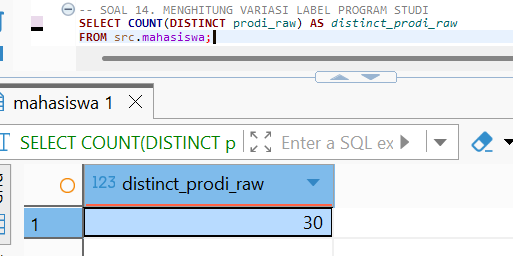

*Keterangan: Hasil penghitungan NIM berbeda pada tabel transaksi dan aktivitas.*

### 18.1 Catatan relasi awal

| Rel ID | Source A | Key A | Source B | Key B | Dugaan hubungan bisnis | Catatan/verifikasi lanjutan |
|---|---|---|---|---|---|---|
| REL01 | `mahasiswa` | `nim` | `krs` | `nim` | 1 mahasiswa : banyak KRS | Periksa apakah seluruh NIM KRS terdapat di mahasiswa |
| REL02 | `mahasiswa` | `nim` | `nilai` | `nim` | 1 mahasiswa : banyak nilai | Periksa orphan key dan NULL |
| REL03 | `mahasiswa` | `nim` | `aktivitas_lms` | `nim` | 1 mahasiswa : banyak aktivitas LMS | Periksa orphan key dan NULL |
| REL04 | `mahasiswa` | `nim` | `pembayaran` | `nim` | 1 mahasiswa : banyak pembayaran | Periksa orphan key dan NULL |
| REL05 | `mahasiswa` | `nim` | `kelulusan` | `nim` | 1 mahasiswa : 0/1 outcome kelulusan secara bisnis | Periksa kesesuaian NIM dan aturan kelulusan |

**Interpretasi:** Empat tabel transaksi/aktivitas, yaitu `krs`, `nilai`, `aktivitas_lms`, dan `pembayaran`, masing-masing memiliki 1.950 NIM berbeda. Tabel `kelulusan` memiliki 345 NIM berbeda. Kesamaan kolom `nim` menunjukkan indikasi relasi dengan tabel `mahasiswa`. Akan tetapi, jumlah NIM berbeda belum membuktikan bahwa seluruh nilai NIM cocok dengan tabel mahasiswa. Perlu pemeriksaan orphan key, nilai NULL, dan validasi constraint sebelum integritas referensial dapat dinyatakan terpenuhi.

---

## 19. Ringkasan Hasil Initial Profiling

| No. | Aspek yang diperiksa | Temuan berdasarkan hasil query | Tindak lanjut yang disarankan |
|---:|---|---|---|
| 1 | Kesiapan environment PostgreSQL | Query versi, database aktif, dan user aktif belum memiliki bukti hasil. | Lengkapi hasil tiga query environment. |
| 2 | Ketersediaan schema dan tabel | DDL mendefinisikan schema `src` dan 10 tabel sumber. | Pastikan hasil inventarisasi sesuai DDL. |
| 3 | Keberhasilan impor dataset | Sepuluh tabel telah berisi data dengan row count sesuai acuan; log `\copy` belum dilampirkan. | Simpan bukti proses impor CSV. |
| 4 | Jumlah baris setiap source | Seluruh sepuluh tabel sesuai nilai acuan. | Gunakan row count sebagai baseline. |
| 5 | Jumlah kolom setiap source | Jumlah kolom berada pada rentang 5–9, kecuali mahasiswa 11 kolom. | Verifikasi dengan `information_schema.columns`. |
| 6 | Keunikan NIM mahasiswa | 1.965 baris, 1.950 NIM berbeda, selisih 15. | Periksa NIM yang berulang dan NULL. |
| 7 | Rentang angkatan | Tahun 2021–2024. | Validasi nilai dan format angkatan. |
| 8 | Kelengkapan kota asal | Terdapat 30 kota asal kosong. | Tentukan penanganan missing value. |
| 9 | Variasi label program studi | 30 label mentah dibandingkan 6 program studi referensi. | Susun pemetaan label pada tahap standardisasi. |
| 10 | Variasi label jenis kelamin | Enam label: F, L, Laki-laki, M, P, dan Perempuan. | Tentukan aturan standardisasi. |
| 11 | Ukuran source terbesar | `aktivitas_lms` memiliki 200.356 baris. | Perhatikan kebutuhan penyimpanan dan optimasi. |
| 12 | Indikasi relasi antartabel | Empat tabel transaksi/aktivitas memiliki 1.950 NIM berbeda; kelulusan 345. | Uji orphan key, NULL, dan integritas referensial. |

---

## 20. Kesimpulan

Praktikum Unit 1.1 menyiapkan source layer pada PostgreSQL melalui schema `src` dan sepuluh tabel sumber sesuai DDL yang diberikan. Hasil pemeriksaan jumlah baris menunjukkan seluruh tabel telah berisi data dan jumlahnya sesuai nilai acuan dataset UADW v1.0. Jumlah kolom setiap tabel diperoleh dari definisi DDL.

Initial profiling pada tabel mahasiswa menunjukkan 1.965 baris dengan 1.950 NIM berbeda, sehingga terdapat selisih 15 yang perlu diperiksa lebih lanjut dan belum dapat langsung dianggap sebagai record yang harus dihapus. Rentang angkatan mahasiswa adalah 2021–2024, sedangkan 30 record memiliki kota asal kosong. Kolom `prodi_raw` memiliki 30 variasi label, sementara tabel referensi hanya memiliki 6 program studi. Kolom `jk_raw` juga menunjukkan enam bentuk representasi.

Tabel `aktivitas_lms` menjadi source dengan jumlah baris terbesar, yaitu 200.356. Kolom `nim` pada tabel transaksi dan aktivitas menunjukkan indikasi relasi dengan tabel mahasiswa, tetapi integritas referensial masih perlu dibuktikan melalui pemeriksaan orphan key dan nilai NULL.

Dengan demikian, source layer telah memiliki struktur dan jumlah data sesuai acuan, sedangkan hasil profiling menunjukkan beberapa hal yang perlu diperiksa pada tahap berikutnya, yaitu indikasi NIM berulang, nilai kota asal kosong, variasi label program studi, variasi label jenis kelamin, dan konsistensi relasi antartabel. Seluruh raw source tetap perlu dipertahankan tanpa cleaning atau deduplikasi pada unit ini.

**Catatan konsistensi:** DDL terakhir yang dikirim mendefinisikan `angkatan` sebagai `TEXT`, sedangkan screenshot struktur tabel menampilkan `integer`. Struktur aktual dan script perlu diselaraskan sebelum laporan dikumpulkan.

---

## Lampiran Bukti Praktikum

- [x] Bukti struktur kolom tabel mahasiswa.
- [x] Bukti hasil profiling candidate key, angkatan, kota asal, program studi, dan jenis kelamin.
- [x] Bukti sampel lima record mahasiswa.
- [x] Bukti jumlah baris source dan NIM berbeda pada tabel transaksi.
- [ ] Bukti versi PostgreSQL, database aktif, dan user aktif.
- [ ] Bukti langsung proses impor sepuluh file CSV.
- [ ] Bukti query inventarisasi dan jumlah kolom seluruh tabel.

## Pernyataan Integritas Data

Saya menyatakan bahwa pada pelaksanaan Unit 1.1, pemeriksaan dilakukan terhadap raw source untuk keperluan persiapan dan *initial profiling*. Saya tidak melakukan cleaning, standardisasi, deduplikasi, `UPDATE`, atau `DELETE` terhadap isi raw source.

| Nama Mahasiswa | Tanggal | Tanda Tangan |
|---|---|---|
|  |  |  |

---

## Catatan Folder Gambar untuk GitHub

Simpan file laporan dan folder `gambar` pada direktori yang sama. Struktur folder yang digunakan:

```text
Laporan/
├── Laporan_Modul_1_Unit_1.1.md
└── gambar/
    ├── unit-1.1_01.png
    ├── unit-1.1_02.png
    ├── unit-1.1_03.png
    ├── ...
    └── unit-1.1_16.png
```

Seluruh tautan gambar pada laporan menggunakan path relatif, misalnya:

```markdown

```

Dengan struktur tersebut, gambar dapat ditampilkan langsung oleh GitHub ketika file Markdown dibuka.
