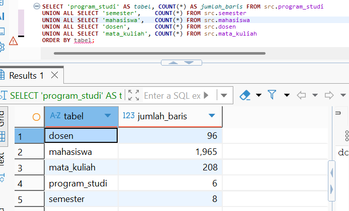
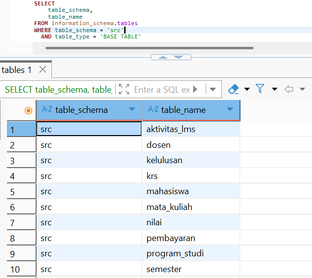
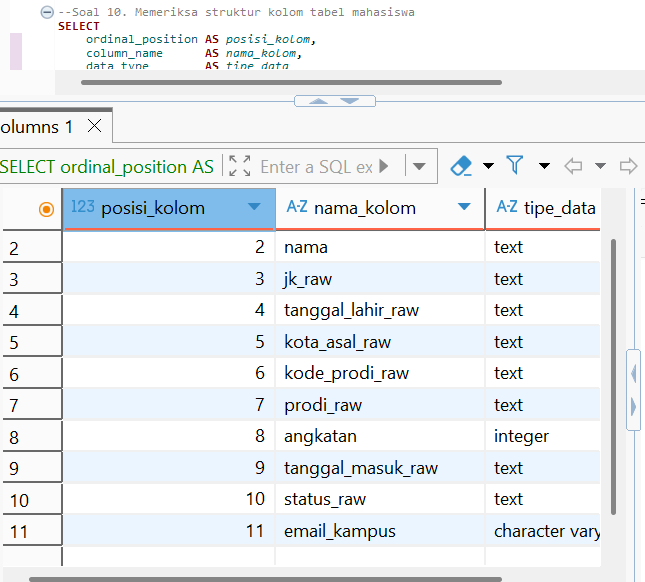
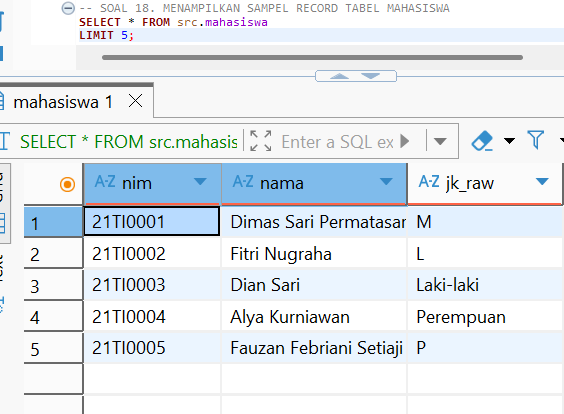
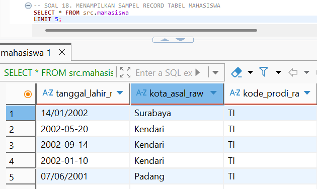
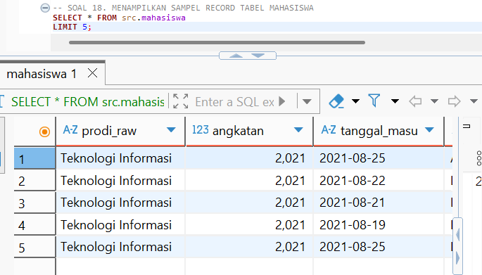

# LAPORAN MODUL 1 – UNIT 1.1
## Persiapan Source Layer dan Initial Data Profiling

**Studi Kasus:** Database Akademik Perguruan Tinggi  
**DBMS:** PostgreSQL  
**Database:** `postgres`  
**Schema:** `src`

---

## Identitas Laporan

| Identitas | Keterangan |
|---|---|
| Nama | Eka Yuliana Rizky |
| NIM | 240306011 |
| Program Studi | Teknologi Informasi |
| Kelas/Kelompok | A / 4 |
| Modul | 1 |
| Unit | 1.1 |
| Tanggal Praktikum | 5 November 2026 |
| Dosen/Instruktur | Adam Bachtiar Maulachela S.Kom., M.MT.|

## Tujuan Praktikum

Praktikum Unit 1.1 bertujuan menyiapkan source layer pada PostgreSQL, memuat dataset raw UADW v1.0, memverifikasi struktur dan jumlah data sumber, serta melakukan *initial profiling* untuk memperoleh gambaran awal karakteristik dataset akademik.

## Ketentuan Praktikum

1. Menggunakan PostgreSQL dan schema `src`.
2. Nilai raw dipertahankan sebagaimana tersedia pada file sumber.
3. Tidak ada cleaning, standardisasi, deduplikasi, `UPDATE`, atau `DELETE` terhadap isi raw source.
4. Path file CSV disesuaikan dengan lokasi dataset pada komputer masing-masing.
5. Seluruh query tersimpan pada file `SQL/modul_1_unit_1.1.sql`.

---

## 1. Verifikasi Environment PostgreSQL

### 1.1 Memeriksa versi PostgreSQL

```sql
SELECT version();
```

**Hasil eksekusi:**


### 1.2 Memeriksa database dan user aktif

```sql
SELECT
    current_database() AS database_aktif,
    current_user      AS user_aktif;
```

**Hasil eksekusi:**


| database_aktif | user_aktif |
|---|---|
| [postgres] | [postgres] |


### 1.3 Memeriksa keberadaan schema `src`

```sql
SELECT schema_name
FROM information_schema.schemata
WHERE schema_name = 'src';
```

**Hasil eksekusi:**


| schema_name |
|---|
| src |


---

## 2. Membuat dan Memverifikasi Source Layer

Source layer menggunakan schema `src` untuk menyimpan data mentah (*raw source*).

| No. | Nama tabel | Peran data | Status pembuatan |
|---:|---|---|---|
| 1 | `src.program_studi` | Master/reference program studi | Berhasil dibuat |
| 2 | `src.semester` | Reference periode akademik | Berhasil dibuat |
| 3 | `src.mahasiswa` | Master mahasiswa | Berhasil dibuat |
| 4 | `src.dosen` | Master dosen | Berhasil dibuat |
| 5 | `src.mata_kuliah` | Master/reference mata kuliah | Berhasil dibuat |
| 6 | `src.krs` | Transaksi pengambilan mata kuliah | Berhasil dibuat |
| 7 | `src.nilai` | Hasil penilaian akademik | Berhasil dibuat |
| 8 | `src.aktivitas_lms` | Aktivitas mahasiswa pada LMS | Berhasil dibuat |
| 9 | `src.pembayaran` | Transaksi pembayaran | Berhasil dibuat |
| 10 | `src.kelulusan` | Data outcome kelulusan | Berhasil dibuat |

### 2.1 Membuat schema dan tabel

**Script DDL yang digunakan:**

```sql
-- Struktur kolom dan urutan mengikuti header file CSV UADW v1.0.
-- Atribut mentah (*_raw) dan atribut kategori disimpan sebagai TEXT agar nilai asli tidak berubah.
CREATE SCHEMA IF NOT EXISTS src;

CREATE TABLE IF NOT EXISTS src.program_studi (
    kode_prodi      TEXT,
    nama_prodi      TEXT,
    fakultas        TEXT,
    departemen      TEXT,
    status          TEXT
);

CREATE TABLE IF NOT EXISTS src.semester (
    semester_id     TEXT,
    tahun_akademik  TEXT,
    term            TEXT,
    urutan_tahun    INTEGER,
    tanggal_mulai   DATE,
    tanggal_selesai DATE
);

CREATE TABLE IF NOT EXISTS src.mahasiswa (
    nim                 TEXT,
    nama                TEXT,
    jk_raw              TEXT,
    tanggal_lahir_raw   TEXT,
    kota_asal_raw       TEXT,
    kode_prodi_raw      TEXT,
    prodi_raw           TEXT,
    angkatan            TEXT,
    tanggal_masuk_raw   TEXT,
    status_raw          TEXT,
    email_kampus        TEXT
);

CREATE TABLE IF NOT EXISTS src.dosen (
    nidn                TEXT,
    nama_dosen          TEXT,
    jk_raw              TEXT,
    unit_prodi_raw      TEXT,
    jabatan_akademik    TEXT,
    tanggal_masuk_raw   TEXT,
    status              TEXT
);

CREATE TABLE IF NOT EXISTS src.mata_kuliah (
    kode_mk              TEXT,
    nama_mk              TEXT,
    kode_prodi           TEXT,
    sks                  INTEGER,
    semester_rekomendasi INTEGER,
    kategori             TEXT,
    aktif                TEXT
);

CREATE TABLE IF NOT EXISTS src.krs (
    krs_id              TEXT,
    nim                 TEXT,
    kode_mk             TEXT,
    semester_id         TEXT,
    kelas               TEXT,
    status_krs          TEXT,
    tanggal_ambil_raw   TEXT,
    sumber_sistem       TEXT
);

CREATE TABLE IF NOT EXISTS src.nilai (
    nilai_id            TEXT,
    nim                 TEXT,
    kode_mk             TEXT,
    semester_id         TEXT,
    nilai_angka         NUMERIC,
    nilai_huruf         TEXT,
    status_lulus        TEXT,
    tanggal_input_raw   TEXT
);

CREATE TABLE IF NOT EXISTS src.aktivitas_lms (
    lms_event_id    TEXT,
    nim             TEXT,
    kode_mk         TEXT,
    semester_id     TEXT,
    waktu_event     TIMESTAMP,
    tipe_event      TEXT,
    durasi_menit    INTEGER,
    skor_kuis       NUMERIC,
    platform        TEXT
);

CREATE TABLE IF NOT EXISTS src.pembayaran (
    pembayaran_id       TEXT,
    nim                 TEXT,
    semester_id         TEXT,
    tanggal_bayar_raw   TEXT,
    nominal_tagihan     NUMERIC,
    nominal_bayar       NUMERIC,
    status_pembayaran   TEXT,
    kanal               TEXT
);

CREATE TABLE IF NOT EXISTS src.kelulusan (
    kelulusan_id        TEXT,
    nim                 TEXT,
    tanggal_lulus_raw   TEXT,
    ipk_final           NUMERIC,
    masa_studi_bulan    INTEGER,
    predikat            TEXT,
    status_tepat_waktu  TEXT
);
```

**Bukti eksekusi / hasil:**


**Catatan:** Perintah `DROP TABLE` dapat menghapus tabel beserta isinya, sehingga tidak digunakan kecuali diperlukan pada tahap persiapan. DDL di atas memakai `IF NOT EXISTS` agar aman dijalankan ulang.

**Interpretasi:** Schema `src` dan sepuluh tabel sumber dibuat sebagai wadah data mentah. Kolom dibuat mengikuti header CSV; atribut `*_raw` dan kategori bertipe teks agar nilai asli (termasuk format tanggal dan label yang beragam) tidak berubah saat dimuat, sedangkan kolom numerik (mis. `nilai_angka`, `nominal_bayar`) bertipe numerik.

---

## 3. Mengimpor/Mengakses Raw Source

### 3.1 Proses impor CSV melalui DBeaver

Sepuluh file CSV diimpor menggunakan fitur **Import Data** pada DBeaver karena praktikum dijalankan melalui DBeaver di Windows. Perintah `\\copy` merupakan perintah khusus `psql` sehingga tidak dijalankan pada SQL Editor DBeaver.

Langkah impor yang dilakukan:
1. Klik kanan tabel tujuan pada schema `src`, lalu pilih **Import Data**.
2. Pilih sumber **CSV** dan tentukan file yang sesuai dari folder `01_raw_data`.
3. Pastikan encoding `UTF-8`, delimiter koma, dan opsi header aktif.
4. Periksa preview serta pemetaan kolom sumber ke kolom tujuan.
5. Klik **Proceed** dan tunggu sampai proses selesai.

| No. | File CSV | Tabel tujuan |
|---:|---|---|
| 1 | `program_studi.csv` | `src.program_studi` |
| 2 | `semester.csv` | `src.semester` |
| 3 | `mahasiswa.csv` | `src.mahasiswa` |
| 4 | `dosen.csv` | `src.dosen` |
| 5 | `mata_kuliah.csv` | `src.mata_kuliah` |
| 6 | `krs.csv` | `src.krs` |
| 7 | `nilai.csv` | `src.nilai` |
| 8 | `aktivitas_lms.csv` | `src.aktivitas_lms` |
| 9 | `pembayaran.csv` | `src.pembayaran` |
| 10 | `kelulusan.csv` | `src.kelulusan` |

**Bukti proses impor:** hasil verifikasi jumlah record pada masing-masing tabel setelah impor ditunjukkan pada Gambar 8 (lihat juga bagian 3.2 dan 6).


### 3.2 Catatan proses impor

| No. | File CSV | Tabel tujuan | Status impor | Jumlah baris yang dilaporkan saat impor | Catatan/error |
|---:|---|---|---|---:|---|
| 1 | `program_studi.csv` | `src.program_studi` | Berhasil | 6 | - |
| 2 | `semester.csv` | `src.semester` | Berhasil | 8 | - |
| 3 | `mahasiswa.csv` | `src.mahasiswa` | Berhasil | 1.965 | - |
| 4 | `dosen.csv` | `src.dosen` | Berhasil | 96 | - |
| 5 | `mata_kuliah.csv` | `src.mata_kuliah` | Berhasil | 208 | - |
| 6 | `krs.csv` | `src.krs` | Berhasil | 57.025 | - |
| 7 | `nilai.csv` | `src.nilai` | Berhasil | 57.000 | - |
| 8 | `aktivitas_lms.csv` | `src.aktivitas_lms` | Berhasil | 200.356 | - |
| 9 | `pembayaran.csv` | `src.pembayaran` | Berhasil | 9.500 | - |
| 10 | `kelulusan.csv` | `src.kelulusan` | Berhasil | 347 | - |

**Bukti proses impor:** hasil query verifikasi jumlah record seluruh tabel setelah impor.



**Interpretasi:** Berdasarkan keluaran impor yang dicatat, kesepuluh file CSV berhasil dimuat ke tabel yang sesuai dan jumlah baris hasil impor sama dengan jumlah baris acuan pada bahan praktikum (lihat bagian 6). Nilai raw dipertahankan dengan memuat file CSV melalui fitur **Import Data** DBeaver (tanpa transformasi), sesuai pemetaan kolom tabel sumber, dan tanpa menjalankan `UPDATE` atau `DELETE` setelah impor.

---

## 4. Menginventarisasi Tabel pada Schema `src`

**Query SQL:**

```sql
SELECT
    table_schema,
    table_name
FROM information_schema.tables
WHERE table_schema = 'src'
  AND table_type = 'BASE TABLE'
ORDER BY table_name;
```

**Hasil eksekusi:**


| table_schema | table_name |
|---|---|
| src | aktivitas_lms |
| src | dosen |
| src | kelulusan |
| src | krs |
| src | mahasiswa |
| src | mata_kuliah |
| src | nilai |
| src | pembayaran |
| src | program_studi |
| src | semester |

**Interpretasi:** Schema `src` berisi 10 base table yang sesuai dengan sepuluh dataset praktikum, sehingga source layer lengkap.

---

## 5. Verifikasi Jumlah Baris Lima Source Awal

**Query SQL:**

```sql
SELECT 'program_studi' AS tabel, COUNT(*) AS jumlah_baris FROM src.program_studi
UNION ALL SELECT 'semester',    COUNT(*) FROM src.semester
UNION ALL SELECT 'mahasiswa',   COUNT(*) FROM src.mahasiswa
UNION ALL SELECT 'dosen',       COUNT(*) FROM src.dosen
UNION ALL SELECT 'mata_kuliah', COUNT(*) FROM src.mata_kuliah
ORDER BY tabel;
```

**Hasil eksekusi:**




| tabel | jumlah_baris |
|---|---:|
| `dosen` | 96 |
| `mahasiswa` | 1.965 |
| `mata_kuliah` | 208 |
| `program_studi` | 6 |
| `semester` | 8 |

**Interpretasi:** Jumlah baris aktual sama dengan jumlah acuan pada bahan praktikum untuk kelima tabel master/reference (6, 8, 1.965, 96, dan 208). Perbedaan tidak ditemukan. Perlu dicatat bahwa jumlah baris `mahasiswa` (1.965) belum berarti 1.965 mahasiswa unik, karena keunikan NIM diperiksa pada bagian 9.

---

## 6. Verifikasi Jumlah Baris Seluruh Sepuluh Source

**Query SQL:**

```sql
SELECT 'program_studi' AS tabel, COUNT(*) AS jumlah_baris FROM src.program_studi
UNION ALL
SELECT 'semester', COUNT(*) FROM src.semester
UNION ALL
SELECT 'mahasiswa', COUNT(*) FROM src.mahasiswa
UNION ALL
SELECT 'dosen', COUNT(*) FROM src.dosen
UNION ALL
SELECT 'mata_kuliah', COUNT(*) FROM src.mata_kuliah
UNION ALL
SELECT 'krs', COUNT(*) FROM src.krs
UNION ALL
SELECT 'nilai', COUNT(*) FROM src.nilai
UNION ALL
SELECT 'aktivitas_lms', COUNT(*) FROM src.aktivitas_lms
UNION ALL
SELECT 'pembayaran', COUNT(*) FROM src.pembayaran
UNION ALL
SELECT 'kelulusan', COUNT(*) FROM src.kelulusan
ORDER BY tabel;
```

**Hasil eksekusi:**


| Dataset | Jumlah baris aktual | Jumlah baris acuan (bila tersedia) | Status/catatan |
|---|---:|---:|---|
| `aktivitas_lms` | 200.356 | 200.356 | Sesuai |
| `dosen` | 96 | 96 | Sesuai |
| `kelulusan` | 347 | 347 | Sesuai |
| `krs` | 57.025 | 57.025 | Sesuai |
| `mahasiswa` | 1.965 | 1.965 | Sesuai |
| `mata_kuliah` | 208 | 208 | Sesuai |
| `nilai` | 57.000 | 57.000 | Sesuai |
| `pembayaran` | 9.500 | 9.500 | Sesuai |
| `program_studi` | 6 | 6 | Sesuai |
| `semester` | 8 | 8 | Sesuai |

**Interpretasi:** Seluruh tabel memiliki jumlah baris yang sama dengan nilai acuan, sehingga pemuatan dinilai lengkap. Tidak ada tabel yang kosong atau kekurangan baris.

---

## 7. Verifikasi Jumlah Kolom Seluruh Source

**Query SQL:**

```sql
SELECT
    table_name   AS nama_tabel,
    COUNT(*)     AS jumlah_kolom
FROM information_schema.columns
WHERE table_schema = 'src'
GROUP BY table_name
ORDER BY table_name;
```

**Hasil eksekusi:**


| table_name | jumlah_kolom |
|---|---:|
| `aktivitas_lms` | 9 |
| `dosen` | 7 |
| `kelulusan` | 7 |
| `krs` | 8 |
| `mahasiswa` | 11 |
| `mata_kuliah` | 7 |
| `nilai` | 8 |
| `pembayaran` | 8 |
| `program_studi` | 5 |
| `semester` | 6 |

**Interpretasi:** Tabel `mahasiswa` memiliki kolom terbanyak (11), sedangkan `program_studi` paling sedikit (5). Jumlah kolom sesuai dengan definisi source pada bahan praktikum.

---

## 8. Verifikasi Struktur Kolom Tabel Mahasiswa

**Query SQL:**

```sql
SELECT
    ordinal_position AS posisi_kolom,
    column_name      AS nama_kolom,
    data_type        AS tipe_data
FROM information_schema.columns
WHERE table_schema = 'src'
  AND table_name = 'mahasiswa'
ORDER BY ordinal_position;
```

**Hasil eksekusi:**


| posisi_kolom | nama_kolom | tipe_data |
|---:|---|---|
| 1 | nim | text |
| 2 | nama | text |
| 3 | jk_raw | text |
| 4 | tanggal_lahir_raw | text |
| 5 | kota_asal_raw | text |
| 6 | kode_prodi_raw | text |
| 7 | prodi_raw | text |
| 8 | angkatan | text |
| 9 | tanggal_masuk_raw | text |
| 10 | status_raw | text |
| 11 | email_kampus | text |

**Interpretasi:** Tabel memiliki 11 kolom dan seluruhnya bertipe `text`, sesuai urutan header CSV. Kolom `*_raw` (`jk_raw`, `tanggal_lahir_raw`, `kota_asal_raw`, `kode_prodi_raw`, `prodi_raw`, `tanggal_masuk_raw`, `status_raw`) menyimpan nilai mentah apa adanya; kolom `angkatan` juga bertipe teks sehingga perlu `CAST` ke integer saat dihitung (lihat bagian 10). Struktur sesuai dengan definisi source pada bahan praktikum.

---

## 9. Verifikasi Candidate Key Mahasiswa

**Query SQL:**

```sql
SELECT
    COUNT(*)                        AS raw_rows,
    COUNT(DISTINCT nim)             AS distinct_nim,
    COUNT(*) - COUNT(DISTINCT nim)  AS excess_duplicate_rows
FROM src.mahasiswa;
```

**Hasil eksekusi:**




| raw_rows | distinct_nim | excess_duplicate_rows |
|---:|---:|---:|
| 1.965 | 1.950 | 15 |

**Analisis:**

- Apakah jumlah seluruh baris sama dengan jumlah NIM unik? **Tidak** (1.965 vs 1.950).
- Apakah terdapat indikasi NIM duplikat? **Ya**, terdapat 15 baris berlebih.
- Apakah hasil ini cukup untuk memutuskan penghapusan record? **Belum**. Hasil hanya menunjukkan selisih jumlah; belum diketahui apakah baris-baris itu identik penuh atau memuat data historis.

**Interpretasi:** NIM **belum terbukti unik** sehingga belum layak dipakai sebagai key tanpa pemeriksaan lanjutan. Pada profiling Unit 1.2, atribut baris duplikat ternyata sama persis, tetapi penanganannya baru dirancang pada tahap cleaning.

**Catatan:** Indikasi duplikasi belum membuktikan bahwa record harus dihapus. Perlu pemeriksaan lanjutan untuk mengetahui apakah record merupakan duplikasi atau data historis.

---

## 10. Mengetahui Rentang Angkatan Mahasiswa

**Query SQL:**

```sql
SELECT
    MIN(CAST(angkatan AS INTEGER)) AS angkatan_min,
    MAX(CAST(angkatan AS INTEGER)) AS angkatan_max
FROM src.mahasiswa;
```

**Hasil eksekusi:**


| angkatan_min | angkatan_max |
|---:|---:|
| 2021 | 2024 |

**Interpretasi:** Dataset mencakup mahasiswa angkatan 2021 sampai 2024 (empat angkatan). Konversi ke integer diperlukan karena kolom disimpan sebagai teks; tanpa konversi, `MIN`/`MAX` mengurutkan secara teks.

---

## 11. Memeriksa Data Kota Asal yang Kosong

**Query SQL:**

```sql
SELECT COUNT(*) AS missing_kota
FROM src.mahasiswa
WHERE kota_asal_raw IS NULL
   OR TRIM(kota_asal_raw) = '';
```

**Hasil eksekusi:**


| missing_kota |
|---:|
| 30 |

**Interpretasi:** Terdapat 30 record (sekitar 1,53% dari 1.965) tanpa kota asal. Dampaknya, analisis persebaran daerah asal mahasiswa menjadi tidak lengkap. Data tidak diisi atau diperbaiki pada tahap ini.

---

## 12. Menghitung Variasi Label Program Studi pada Mahasiswa

**Query SQL:**

```sql
SELECT COUNT(DISTINCT prodi_raw) AS distinct_prodi_raw
FROM src.mahasiswa;
```

**Hasil eksekusi:**


| distinct_prodi_raw |
|---:|
| 30 |

**Interpretasi:** Terdapat 30 label berbeda pada `prodi_raw`, padahal program studi resmi hanya 6 (lihat bagian 13). Jumlahnya tidak sama, sehingga terindikasi variasi penulisan nama program studi.

---

## 13. Menghitung Jumlah Program Studi pada Tabel Referensi

**Query SQL:**

```sql
SELECT COUNT(*) AS canonical_programs
FROM src.program_studi;
```

**Hasil eksekusi:**


| canonical_programs |
|---:|
| 6 |

**Perbandingan:**

| Keterangan | Jumlah |
|---|---:|
| Variasi label `prodi_raw` | 30 |
| Record pada `src.program_studi` | 6 |

**Interpretasi:** Tabel referensi memuat 6 nama resmi sehingga menjadi pembanding awal bagi `prodi_raw`. Selisih 24 label menunjukkan adanya variasi representasi (singkatan, kapitalisasi, penulisan lain) pada data mahasiswa.

---

## 14. Menampilkan Distribusi Label Program Studi Mentah

**Query SQL:**

```sql
SELECT
    prodi_raw,
    COUNT(*) AS jumlah
FROM src.mahasiswa
GROUP BY prodi_raw
ORDER BY prodi_raw;
```

**Hasil eksekusi:**


| prodi_raw | jumlah |
|---|---:|
| BD | 21 |
| Bisnis Dig. | 18 |
| BISNIS DIGITAL | 12 |
| Bisnis Digital | 229 |
| Bisnis digital | 15 |
| Data Science | 8 |
| DS | 25 |
| IF | 34 |
| INFORMATIKA | 16 |
| Informatika | 276 |
| informatika | 20 |
| SAINS DATA | 11 |
| Sains Data | 234 |
| Sains data | 15 |
| SI | 17 |
| Sist. Informasi | 17 |
| SISTEM INFORMASI | 18 |
| Sistem Informasi | 281 |
| Sistem informasi | 19 |
| Tek. Informasi | 25 |
| Tek. Rekayasa Komputer | 16 |
| Teknik Informatika | 25 |
| TEKNOLOGI INFORMASI | 24 |
| Teknologi Informasi | 286 |
| Teknologi informasi | 13 |
| TEKNOLOGI REKAYASA KOMPUTER | 12 |
| Teknologi Rekayasa Komputer | 224 |
| TI | 25 |
| TR | 13 |
| TRK | 16 |


**Interpretasi:** Label dengan frekuensi terbesar adalah *Teknologi Informasi* (286). Sebanyak 435 record (22,1%) memakai 24 label non-canonical seperti singkatan (IF, TI, DS, BD) dan kapitalisasi berbeda (TEKNOLOGI INFORMASI), yang perlu diperiksa lebih lanjut sebelum standardisasi.

---

## 15. Menampilkan Variasi Label Jenis Kelamin

**Query SQL:**

```sql
SELECT
    jk_raw,
    COUNT(*) AS jumlah
FROM src.mahasiswa
GROUP BY jk_raw
ORDER BY jk_raw;
```

**Hasil eksekusi:**


| jk_raw | jumlah |
|---|---:|
| F | 39 |
| L | 764 |
| Laki-laki | 162 |
| M | 53 |
| P | 764 |
| Perempuan | 183 |

**Interpretasi:** Ada 6 label untuk 2 konsep jenis kelamin (L/Laki-laki/M dan P/Perempuan/F). Standardisasi diperlukan pada tahap berikutnya agar agregasi per jenis kelamin tidak terpecah, tetapi tidak dilakukan pada tabel raw.

---

## 16. Menampilkan Sampel Record Tabel Mahasiswa

**Query SQL:**

```sql
SELECT *
FROM src.mahasiswa
LIMIT 5;
```

**Hasil eksekusi:**







| nim | nama | jk_raw | tanggal_lahir_raw | kota_asal_raw | kode_prodi_raw | prodi_raw | angkatan | tanggal_masuk_raw | status_raw | email_kampus |
|---|---|---|---|---|---|---|---|---|---|---|
| 21TI0001 | Dimas Sari Permatasari | M | 14/01/2002 | Surabaya | TI | Teknologi Informasi | 2021 | 2021-08-25 | Aktif | 21ti0001@student.uadw.ac.id |
| 21TI0002 | Fitri Nugraha | L | 2002-05-20 | Kendari | TI | Teknologi Informasi | 2021 | 2021-08-22 | Lulus | 21ti0002@student.uadw.ac.id |
| 21TI0003 | Dian Sari | Laki-laki | 2002-09-14 | Kendari | TI | Teknologi Informasi | 2021 | 2021-08-21 | Lulus | 21ti0003@student.uadw.ac.id |
| 21TI0004 | Alya Kurniawan | Perempuan | 2002-01-10 | Kendari | TI | Teknologi Informasi | 2021 | 2021-08-19 | Lulus | 21ti0004@student.uadw.ac.id |
| 21TI0005 | Fauzan Febriani Setiaji | P | 07/06/2001 | Padang | TI | Teknologi Informasi | 2021 | 2021-08-25 | Lulus | 21ti0005@student.uadw.ac.id |

*Lima baris pertama berdasarkan urutan baris pada file sumber (tanpa `ORDER BY`).*

**Interpretasi:** Sampel membantu memahami bentuk dan isi tiap kolom: NIM berpola tahun-kode prodi-nomor (mis. 21TI0001), jenis kelamin muncul dengan beberapa bentuk (M, L, Laki-laki, Perempuan, P), dan tanggal lahir memakai format berbeda (14/01/2002 dan 2002-05-20). Namun lima baris hanya sebagian kecil dari 1.965 baris sehingga tidak cukup untuk menyimpulkan kualitas seluruh dataset; masalah seperti duplikasi, nilai kosong, atau variasi label baru terlihat lewat agregasi pada seluruh data.

---

## 17. Mengidentifikasi Source dengan Jumlah Baris Terbesar

**Query SQL:**

```sql
SELECT 'program_studi' AS source, COUNT(*) AS jumlah_baris FROM src.program_studi
UNION ALL
SELECT 'semester', COUNT(*) FROM src.semester
UNION ALL
SELECT 'mahasiswa', COUNT(*) FROM src.mahasiswa
UNION ALL
SELECT 'dosen', COUNT(*) FROM src.dosen
UNION ALL
SELECT 'mata_kuliah', COUNT(*) FROM src.mata_kuliah
UNION ALL
SELECT 'krs', COUNT(*) FROM src.krs
UNION ALL
SELECT 'nilai', COUNT(*) FROM src.nilai
UNION ALL
SELECT 'aktivitas_lms', COUNT(*) FROM src.aktivitas_lms
UNION ALL
SELECT 'pembayaran', COUNT(*) FROM src.pembayaran
UNION ALL
SELECT 'kelulusan', COUNT(*) FROM src.kelulusan
ORDER BY jumlah_baris DESC;
```

**Hasil eksekusi:**




| source | rows |
|---|---:|
| aktivitas_lms | 200.356 |
| krs | 57.025 |
| nilai | 57.000 |
| pembayaran | 9.500 |
| mahasiswa | 1.965 |
| kelulusan | 347 |
| mata_kuliah | 208 |
| dosen | 96 |
| semester | 8 |
| program_studi | 6 |

**Source dengan jumlah baris terbanyak:** `aktivitas_lms`

**Jumlah baris:** 200.356

**Interpretasi:** `aktivitas_lms` adalah tabel terbesar karena mencatat setiap aktivitas mahasiswa di LMS. Informasi ukuran berguna untuk merencanakan beban pemrosesan, pembagian proses (*batch*), dan prioritas optimasi pada pengolahan data berikutnya.

---

## 18. Mengidentifikasi Indikasi Relasi Mahasiswa dengan Tabel Transaksi

**Query SQL:**

```sql
SELECT 'krs' AS tabel, COUNT(DISTINCT nim) AS jumlah_nim_unik FROM src.krs
UNION ALL SELECT 'nilai',         COUNT(DISTINCT nim) FROM src.nilai
UNION ALL SELECT 'aktivitas_lms', COUNT(DISTINCT nim) FROM src.aktivitas_lms
UNION ALL SELECT 'pembayaran',    COUNT(DISTINCT nim) FROM src.pembayaran
UNION ALL SELECT 'kelulusan',     COUNT(DISTINCT nim) FROM src.kelulusan;
```

**Hasil eksekusi:**


| source | distinct_nim |
|---|---:|
| `krs` | 1.950 |
| `nilai` | 1.950 |
| `aktivitas_lms` | 1.950 |
| `pembayaran` | 1.950 |
| `kelulusan` | 345 |

### 18.1 Catatan relasi awal

| Rel ID | Source A | Key A | Source B | Key B | Dugaan hubungan bisnis | Catatan/verifikasi lanjutan |
|---|---|---|---|---|---|---|
| REL01 | `mahasiswa` | `nim` | `krs` | `nim` | 1 mahasiswa : banyak KRS | Uji orphan NIM KRS terhadap mahasiswa |
| REL02 | `mahasiswa` | `nim` | `nilai` | `nim` | 1 mahasiswa : banyak nilai | Uji orphan NIM nilai; cocokkan dengan KRS |
| REL03 | `mahasiswa` | `nim` | `aktivitas_lms` | `nim` | 1 mahasiswa : banyak aktivitas LMS | Uji orphan NIM LMS |
| REL04 | `mahasiswa` | `nim` | `pembayaran` | `nim` | 1 mahasiswa : banyak pembayaran | Uji orphan NIM pembayaran |
| REL05 | `mahasiswa` | `nim` | `kelulusan` | `nim` | 1 mahasiswa : 0/1 outcome kelulusan secara bisnis | Uji duplikasi kelulusan dan orphan NIM |

**Interpretasi:** Kolom `nim` muncul pada tabel mahasiswa dan kelima tabel transaksi/aktivitas, sehingga terindikasi relasi satu-ke-banyak antara mahasiswa dan transaksi (kecuali kelulusan yang secara bisnis 0 atau 1 per mahasiswa). Jumlah NIM unik pada `krs`, `nilai`, `aktivitas_lms`, dan `pembayaran` (masing-masing 1.950) sama dengan jumlah NIM unik pada `mahasiswa`, sedangkan `kelulusan` hanya 345 karena tidak semua mahasiswa sudah lulus. Namun kesamaan nama kolom dan jumlah NIM berbeda **belum membuktikan integritas referensial**; pemeriksaan lanjutan (uji orphan dengan `LEFT JOIN`) dilakukan pada Unit 1.2.

---

## 19. Ringkasan Hasil Initial Profiling

| No. | Aspek yang diperiksa | Temuan berdasarkan hasil query | Tindak lanjut yang disarankan |
|---:|---|---|---|
| 1 | Kesiapan environment PostgreSQL | Server dan database dapat diakses; versi dan user tercatat | Pertahankan konfigurasi untuk unit berikutnya |
| 2 | Ketersediaan schema dan tabel | Schema `src` dan 10 tabel tersedia | Tidak ada |
| 3 | Keberhasilan impor dataset | 10 file CSV termuat; jumlah baris sesuai acuan | Pertahankan raw data tanpa perubahan |
| 4 | Jumlah baris setiap source | 6 s.d. 200.356 baris; sesuai acuan | Tidak ada |
| 5 | Jumlah kolom setiap source | 5 s.d. 11 kolom | Tidak ada |
| 6 | Keunikan NIM mahasiswa | 1.965 baris vs 1.950 NIM unik; 15 baris berlebih | Selidiki apakah duplikat persis atau historis |
| 7 | Rentang angkatan | 2021 s.d. 2024 | Tidak ada |
| 8 | Kelengkapan kota asal | 30 record kosong (1,53%) | Tentukan penanganan pada ETL |
| 9 | Variasi label program studi | 30 label vs 6 program studi resmi | Susun tabel mapping label ke kode prodi |
| 10 | Variasi label jenis kelamin | 6 label untuk 2 konsep | Standardisasi ke L/P pada tahap transformasi |
| 11 | Ukuran source terbesar | `aktivitas_lms` (200.356 baris) | Rencanakan pemrosesan bertahap |
| 12 | Indikasi relasi antartabel | `nim` muncul di 5 tabel transaksi | Uji integritas referensial pada Unit 1.2 |

---

## 20. Kesimpulan

Source layer pada schema `src` telah siap: schema dan sepuluh tabel berhasil dibuat serta seluruh file CSV UADW v1.0 berhasil dimuat tanpa mengubah nilai raw. Jumlah baris setiap tabel sesuai dengan nilai acuan (dari 6 baris pada `program_studi` hingga 200.356 baris pada `aktivitas_lms`) dan jumlah kolom sesuai definisi source.

Initial profiling pada tabel `mahasiswa` menunjukkan beberapa karakteristik awal: NIM belum terbukti unik (1.965 baris vs 1.950 NIM unik), angkatan mencakup 2021–2024, 30 record tidak memiliki kota asal, terdapat 30 variasi label program studi untuk 6 program studi resmi, dan 6 variasi label untuk 2 konsep jenis kelamin. Kolom `nim` juga muncul pada lima tabel transaksi sehingga terindikasi relasi dengan mahasiswa.

Temuan tersebut hanya dicatat dan tidak diperbaiki pada unit ini. Unit berikutnya perlu memeriksa lebih dalam duplikasi (apakah identik penuh atau historis), kelengkapan, validitas, konsistensi format, dan integritas referensial antartabel sebelum dilakukan cleaning dan standardisasi.
