# LAPORAN MODUL 1 – UNIT 1.1
## Persiapan Source Layer dan Initial Data Profiling

**Studi Kasus:** Database Akademik Perguruan Tinggi  
**DBMS:** PostgreSQL  
**Database:** `postgres`  
**Schema:** `src`

---

## Identitas Laporan

| Identitas | Keterangan |
|---|---|
| Nama | Annisa Almaghvirah |
| NIM | 240306037 |
| Program Studi | Teknologi Informasi |
| Kelas/Kelompok | A / 4 |
| Modul | 1 |
| Unit | 1.1 |
| Tanggal Praktikum | 5 November 2026 |
| Dosen/Instruktur | Adam Bachtiar Maulachela S.Kom., M.MT.|

## Tujuan Praktikum

Praktikum Unit 1.1 bertujuan menyiapkan source layer pada PostgreSQL, memuat dataset raw UADW v1.0, memverifikasi struktur dan jumlah data sumber, serta melakukan *initial profiling* untuk memperoleh gambaran awal karakteristik dataset akademik.

## Ketentuan Praktikum

1. Gunakan PostgreSQL dan schema `src`.
2. Pertahankan nilai raw sebagaimana tersedia pada file sumber.
3. Jangan melakukan proses cleaning, standardisasi, deduplikasi, `UPDATE`, atau `DELETE` terhadap isi raw source pada unit ini.
4. Sesuaikan path file CSV dengan lokasi dataset pada komputer masing-masing.
5. Untuk setiap aktivitas query, cantumkan query yang dijalankan, hasil eksekusi, dan interpretasi.
6. Apabila hasil aktual berbeda dari nilai acuan pada bahan praktikum, catat perbedaannya dan lakukan pemeriksaan; jangan mengubah data hanya agar hasilnya sama.

---

## 1. Verifikasi Environment PostgreSQL

### 1.1 Memeriksa versi PostgreSQL

Query yang digunakan:

```sql
SELECT version();
```

**Hasil eksekusi:**


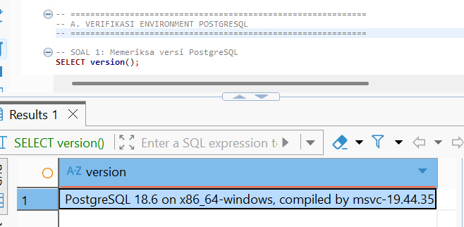

### 1.2 Memeriksa database dan user aktif

```sql
SELECT
    current_database() AS database_aktif,
    current_user      AS user_aktif;
```

**Hasil eksekusi:**

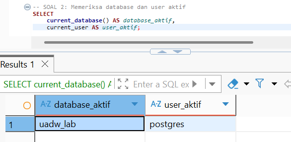


### 1.3 Memeriksa keberadaan schema `src`

Query yang digunakan:

```sql
SELECT schema_name
FROM information_schema.schemata
WHERE schema_name = 'src';
```

**Hasil eksekusi:**

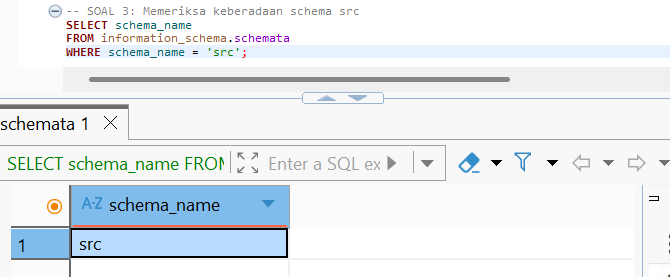


---

## 2. Membuat dan Memverifikasi Source Layer

Source layer menggunakan schema `src` untuk menyimpan data mentah (*raw source*).

| No. | Nama tabel | Peran data | Status pembuatan |
|---:|---|---|---|
| 1 | `src.program_studi` | Master/reference program studi | Berhasil dibuat |
| 2 | `src.semester` | Reference periode akademik | Berhasil dibuat |
| 3 | `src.mahasiswa` | Master mahasiswa | Berhasil dibuat |
| 4 | `src.dosen` | Master dosen | Berhasil dibuat |
| 5 | `src.mata_kuliah` | Master/reference mata kuliah | Berhasil dibuat |
| 6 | `src.krs` | Transaksi pengambilan mata kuliah | Berhasil dibuat |
| 7 | `src.nilai` | Hasil penilaian akademik | Berhasil dibuat |
| 8 | `src.aktivitas_lms` | Aktivitas mahasiswa pada LMS | Berhasil dibuat |
| 9 | `src.pembayaran` | Transaksi pembayaran | Berhasil dibuat |
| 10 | `src.kelulusan` | Data outcome kelulusan | Berhasil dibuat |

### 2.1 Membuat schema dan tabel

**Script DDL yang digunakan:**

```sql
-- 1. Membuat schema src
CREATE SCHEMA IF NOT EXISTS src;

-- 2. Membuat sepuluh tabel sumber 
-- Membuat tabel program_studi
CREATE TABLE IF NOT EXISTS src.program_studi (
    kode_prodi TEXT,
    nama_prodi TEXT,
    fakultas TEXT,
    departemen TEXT,
    status TEXT
);

-- Membuat tabel semester
CREATE TABLE IF NOT EXISTS src.semester (
    semester_id TEXT,
    tahun_akademik TEXT,
    term TEXT,
    urutan_tahun INTEGER,
    tanggal_mulai TEXT,
    tanggal_selesai TEXT
);

-- Membuat tabel mahasiswa
CREATE TABLE IF NOT EXISTS src.mahasiswa (
    nim TEXT,
    nama TEXT,
    jk_raw TEXT,
    tanggal_lahir_raw TEXT,
    kota_asal_raw TEXT,
    kode_prodi_raw TEXT,
    prodi_raw TEXT,
    angkatan TEXT,
    tanggal_masuk_raw TEXT,
    status_raw TEXT,
    email_kampus TEXT
);

-- Membuat tabel dosen
CREATE TABLE IF NOT EXISTS src.dosen (
    nidn TEXT,
    nama_dosen TEXT,
    jk_raw TEXT,
    unit_prodi_raw TEXT,
    jabatan_akademik TEXT,
    tanggal_masuk_raw TEXT,
    status TEXT
);

-- Membuat tabel mata_kuliah
CREATE TABLE IF NOT EXISTS src.mata_kuliah (
    kode_mk TEXT,
    nama_mk TEXT,
    kode_prodi TEXT,
    sks INTEGER,
    semester_rekomendasi INTEGER,
    kategori TEXT,
    aktif TEXT
);

-- Membuat tabel krs
CREATE TABLE IF NOT EXISTS src.krs (
    krs_id TEXT,
    nim TEXT,
    kode_mk TEXT,
    semester_id TEXT,
    kelas TEXT,
    status_krs TEXT,
    tanggal_ambil_raw TEXT,
    sumber_sistem TEXT
);

-- Membuat tabel nilai
CREATE TABLE IF NOT EXISTS src.nilai (
    nilai_id TEXT,
    nim TEXT,
    kode_mk TEXT,
    semester_id TEXT,
    nilai_angka NUMERIC(6,2),
    nilai_huruf TEXT,
    status_lulus TEXT,
    tanggal_input_raw TEXT
);

-- 9. Membuat tabel aktivitas_lms
CREATE TABLE IF NOT EXISTS src.aktivitas_lms (
    lms_event_id TEXT,
    nim TEXT,
    kode_mk TEXT,
    semester_id TEXT,
    waktu_event TEXT,
    tipe_event TEXT,
    durasi_menit INTEGER,
    skor_kuis NUMERIC(6,2),
    platform TEXT
);

-- Membuat tabel pembayaran
CREATE TABLE IF NOT EXISTS src.pembayaran (
    pembayaran_id TEXT,
    nim TEXT,
    semester_id TEXT,
    tanggal_bayar_raw TEXT,
    nominal_tagihan BIGINT,
    nominal_bayar BIGINT,
    status_pembayaran TEXT,
    kanal TEXT
);

-- Membuat tabel kelulusan
CREATE TABLE IF NOT EXISTS src.kelulusan (
    kelulusan_id TEXT,
    nim TEXT,
    tanggal_lulus_raw TEXT,
    ipk_final NUMERIC(4,2),
    masa_studi_bulan INTEGER,
    predikat TEXT,
    status_tepat_waktu TEXT
);

```

**Bukti eksekusi / hasil:**


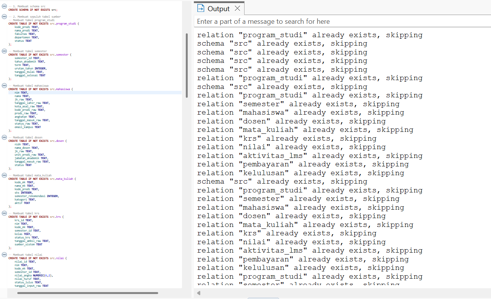

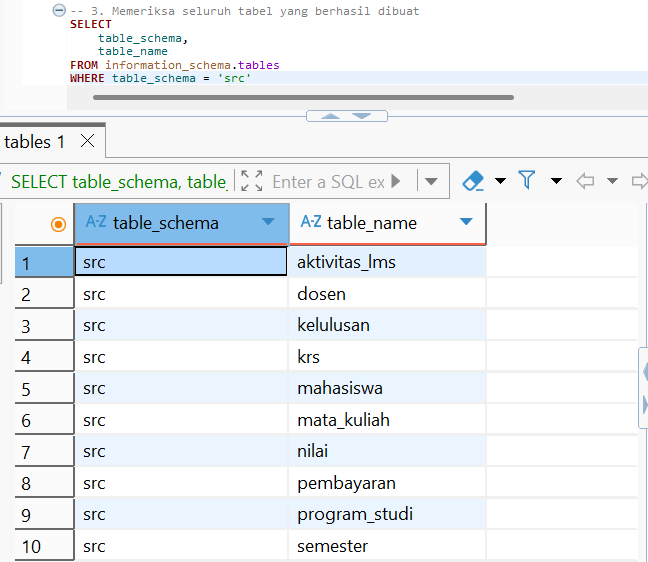


**Catatan:** Perintah `DROP TABLE` dapat menghapus tabel beserta isinya, sehingga tidak digunakan kecuali diperlukan pada tahap persiapan. DDL di atas memakai `IF NOT EXISTS` agar aman dijalankan ulang.

**Interpretasi:** Schema `src` dan sepuluh tabel sumber dibuat sebagai wadah data mentah. Kolom dibuat mengikuti header CSV; atribut `*_raw` dan kategori bertipe teks agar nilai asli (termasuk format tanggal dan label yang beragam) tidak berubah saat dimuat, sedangkan kolom numerik (mis. `nilai_angka`, `nominal_bayar`) bertipe numerik.

---

## 3. Mengimpor/Mengakses Raw Source

### 3.1 Proses impor CSV melalui DBeaver

Sepuluh file CSV diimpor menggunakan fitur Import Data pada DBeaver karena praktikum dijalankan melalui DBeaver di Windows. Perintah \\copy merupakan perintah khusus psql sehingga tidak dijalankan pada SQL Editor DBeaver.

Langkah impor yang dilakukan:

1. Klik kanan tabel tujuan pada schema src, lalu pilih Import Data.
2. Pilih sumber CSV dan tentukan file yang sesuai dari folder 01_raw_data.
3. Pastikan encoding UTF-8, delimiter koma, dan opsi header aktif.
4. Periksa preview serta pemetaan kolom sumber ke kolom tujuan.
5. Klik Proceed dan tunggu sampai proses selesai.

| No. | File CSV | Tabel tujuan |
|---:|---|---|
| 1 | `program_studi.csv` | `src.program_studi` |
| 2 | `semester.csv` | `src.semester` |
| 3 | `mahasiswa.csv` | `src.mahasiswa` |
| 4 | `dosen.csv` | `src.dosen` |
| 5 | `mata_kuliah.csv` | `src.mata_kuliah` |
| 6 | `krs.csv` | `src.krs` |
| 7 | `nilai.csv` | `src.nilai` |
| 8 | `aktivitas_lms.csv` | `src.aktivitas_lms` |
| 9 | `pembayaran.csv` | `src.pembayaran` |
| 10 | `kelulusan.csv` | `src.kelulusan` |

**Bukti proses impor:** hasil verifikasi jumlah record pada masing-masing tabel setelah impor ditunjukkan pada Gambar 8 (lihat juga bagian 3.2 dan 6).


### 3.2 Catatan proses impor

| No. | File CSV | Tabel tujuan | Status impor | Jumlah baris yang dilaporkan saat impor | Catatan/error |
|---:|---|---|---|---:|---|
| 1 | `program_studi.csv` | `src.program_studi` | Berhasil | 6 | - |
| 2 | `semester.csv` | `src.semester` | Berhasil | 8 | - |
| 3 | `mahasiswa.csv` | `src.mahasiswa` | Berhasil | 1.965 | - |
| 4 | `dosen.csv` | `src.dosen` | Berhasil | 96 | - |
| 5 | `mata_kuliah.csv` | `src.mata_kuliah` | Berhasil | 208 | - |
| 6 | `krs.csv` | `src.krs` | Berhasil | 57.025 | - |
| 7 | `nilai.csv` | `src.nilai` | Berhasil | 57.000 | - |
| 8 | `aktivitas_lms.csv` | `src.aktivitas_lms` | Berhasil | 200.356 | - |
| 9 | `pembayaran.csv` | `src.pembayaran` | Berhasil | 9.500 | - |
| 10 | `kelulusan.csv` | `src.kelulusan` | Berhasil | 347 | - |

**Bukti proses impor:** hasil query verifikasi jumlah record seluruh tabel setelah impor.

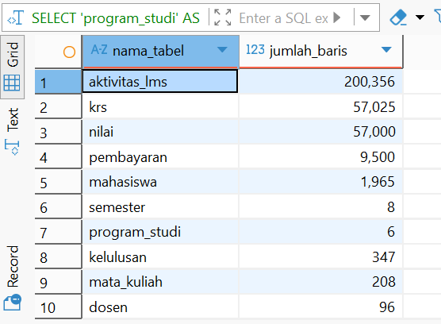

**Interpretasi:** Proses impor sepuluh file CSV ke tabel tujuan pada schema `src` berhasil dilakukan melalui fitur Import Data di DBeaver. Berdasarkan catatan hasil impor, jumlah baris yang masuk berkisar dari 6 baris pada `program_studi` hingga 200.356 baris pada `aktivitas_lms`. Jumlah tersebut selanjutnya diverifikasi kembali menggunakan query `COUNT(*)` agar dapat dipastikan bahwa data telah termuat sesuai jumlah yang dilaporkan.

---

## 4. Menginventarisasi Tabel pada Schema `src`

**Query SQL:**

```sql
SELECT
    table_schema,
    table_name
FROM information_schema.tables
WHERE table_schema = 'src'
  AND table_type = 'BASE TABLE'
ORDER BY table_name;
```

**Hasil eksekusi:**

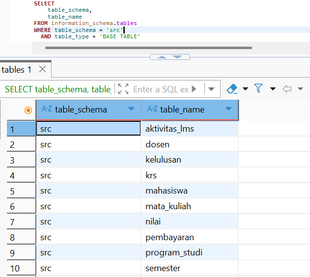


**Interpretasi:** Schema `src` berisi 10 base table yang sesuai dengan sepuluh dataset praktikum, sehingga source layer lengkap.

---

## 5. Verifikasi Jumlah Baris Lima Source Awal

**Query SQL:**

```sql
SELECT 'program_studi' AS tabel, COUNT(*) AS jumlah_baris FROM src.program_studi
UNION ALL SELECT 'semester',    COUNT(*) FROM src.semester
UNION ALL SELECT 'mahasiswa',   COUNT(*) FROM src.mahasiswa
UNION ALL SELECT 'dosen',       COUNT(*) FROM src.dosen
UNION ALL SELECT 'mata_kuliah', COUNT(*) FROM src.mata_kuliah
ORDER BY tabel;
```

**Hasil eksekusi:**

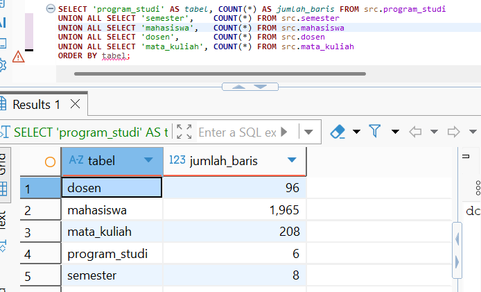

Dataset	Jumlah baris aktual	Jumlah baris acuan (bila tersedia)	Status/catatan
aktivitas_lms	200.356	200.356	Sesuai
dosen	96	96	Sesuai
kelulusan	347	347	Sesuai
krs	57.025	57.025	Sesuai
mahasiswa	1.965	1.965	Sesuai
mata_kuliah	208	208	Sesuai
nilai	57.000	57.000	Sesuai
pembayaran	9.500	9.500	Sesuai
program_studi	6	6	Sesuai
semester	8	8	Sesuai

**Interpretasi:** Lima tabel master/reference berhasil diverifikasi memiliki jumlah baris yang berbeda sesuai fungsinya. Tabel `mahasiswa` berisi 1.965 baris, `mata_kuliah` 208 baris, `dosen` 96 baris, `semester` 8 baris, dan `program_studi` 6 baris. Hasil ini menunjukkan bahwa data pada kelima tabel telah tersedia dan dapat digunakan sebagai sumber referensi untuk proses profiling berikutnya.

---

## 6. Verifikasi Jumlah Baris Seluruh Sepuluh Source

**Query SQL:**

```sql
SELECT 'program_studi' AS tabel, COUNT(*) AS jumlah_baris FROM src.program_studi
UNION ALL
SELECT 'semester', COUNT(*) FROM src.semester
UNION ALL
SELECT 'mahasiswa', COUNT(*) FROM src.mahasiswa
UNION ALL
SELECT 'dosen', COUNT(*) FROM src.dosen
UNION ALL
SELECT 'mata_kuliah', COUNT(*) FROM src.mata_kuliah
UNION ALL
SELECT 'krs', COUNT(*) FROM src.krs
UNION ALL
SELECT 'nilai', COUNT(*) FROM src.nilai
UNION ALL
SELECT 'aktivitas_lms', COUNT(*) FROM src.aktivitas_lms
UNION ALL
SELECT 'pembayaran', COUNT(*) FROM src.pembayaran
UNION ALL
SELECT 'kelulusan', COUNT(*) FROM src.kelulusan
ORDER BY tabel;
```

**Hasil eksekusi:**

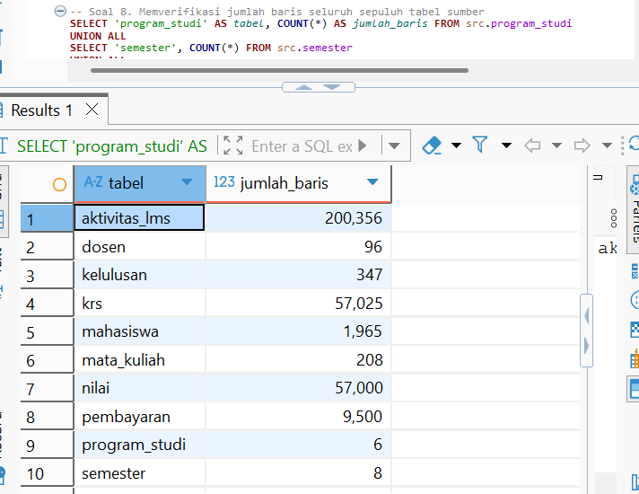


**Interpretasi:** Seluruh tabel memiliki jumlah baris yang sama dengan nilai acuan, sehingga pemuatan dinilai lengkap. Tidak ada tabel yang kosong atau kekurangan baris.

---

## 7. Verifikasi Jumlah Kolom Seluruh Source

**Query SQL:**

```sql
SELECT
    table_name,
    COUNT(*) AS jumlah_kolom
FROM information_schema.columns
WHERE table_schema = 'src'
GROUP BY table_name
ORDER BY table_name;
```

**Hasil eksekusi:**

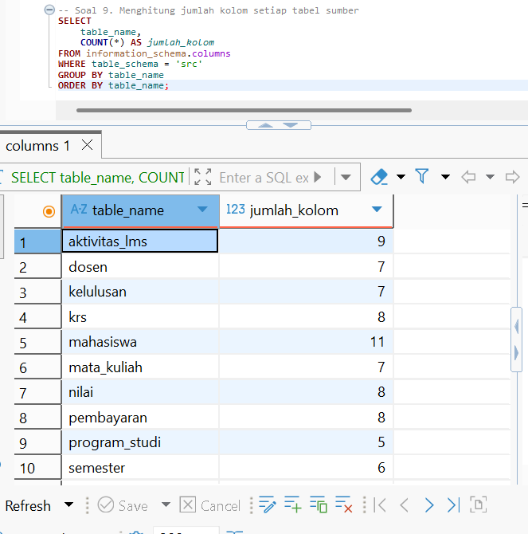


**Interpretasi:** Berdasarkan hasil query, jumlah kolom pada setiap tabel berada pada rentang 5 sampai 11 kolom. Tabel `mahasiswa` memiliki jumlah kolom terbanyak, yaitu 11 kolom, sedangkan `program_studi` memiliki jumlah kolom paling sedikit, yaitu 5 kolom. Jumlah kolom tersebut sesuai dengan struktur source yang digunakan dalam praktikum.

---

## 8. Verifikasi Struktur Kolom Tabel Mahasiswa

**Query SQL:**

```sql
SELECT
    ordinal_position AS posisi_kolom,
    column_name      AS nama_kolom,
    data_type        AS tipe_data
FROM information_schema.columns
WHERE table_schema = 'src'
  AND table_name = 'mahasiswa'
ORDER BY ordinal_position;
```

**Hasil eksekusi:**

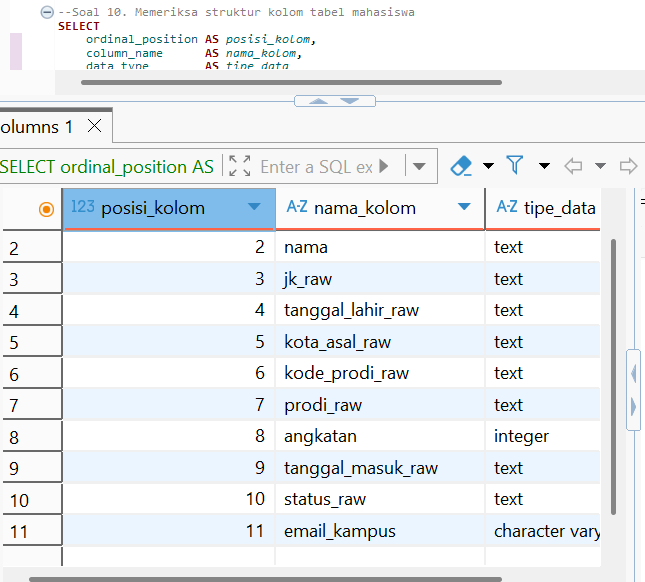


**Interpretasi:** Tabel `mahasiswa` memiliki 11 kolom sesuai urutan header CSV. Berdasarkan hasil verifikasi, 10 kolom bertipe `text`, sedangkan kolom `angkatan` bertipe `integer`. Kolom-kolom yang menggunakan akhiran `_raw` tetap menyimpan nilai sumber tanpa standardisasi pada tahap ini. Karena `angkatan` sudah bertipe `integer`, nilai minimum dan maksimum dapat dihitung secara numerik tanpa perlu mengubah tipe datanya terlebih dahulu.
---

## 9. Verifikasi Candidate Key Mahasiswa

**Query SQL:**

```sql
SELECT
    COUNT(*) AS raw_rows,
    COUNT(DISTINCT nim) AS distinct_nim,
    COUNT(*) - COUNT(DISTINCT nim) AS excess_duplicate_rows
FROM src.mahasiswa;
```

**Hasil eksekusi:**


**Analisis:**

- Apakah jumlah seluruh baris sama dengan jumlah NIM unik? **Tidak** (1.965 vs 1.950).
- Apakah terdapat indikasi NIM duplikat? **Ya**, terdapat 15 baris berlebih.
- Apakah hasil ini cukup untuk memutuskan penghapusan record? **Belum**. Hasil hanya menunjukkan selisih jumlah; belum diketahui apakah baris-baris itu identik penuh atau memuat data historis.

**Interpretasi:** NIM **belum terbukti unik** sehingga belum layak dipakai sebagai key tanpa pemeriksaan lanjutan. Pada profiling Unit 1.2, atribut baris duplikat ternyata sama persis, tetapi penanganannya baru dirancang pada tahap cleaning.

**Catatan:** Indikasi duplikasi belum membuktikan bahwa record harus dihapus. Perlu pemeriksaan lanjutan untuk mengetahui apakah record merupakan duplikasi atau data historis.

---

## 10. Mengetahui Rentang Angkatan Mahasiswa

**Query SQL:**

```sql
SELECT
    MIN(CAST(angkatan AS INTEGER)) AS angkatan_min,
    MAX(CAST(angkatan AS INTEGER)) AS angkatan_max
FROM src.mahasiswa;
```

**Hasil eksekusi:**

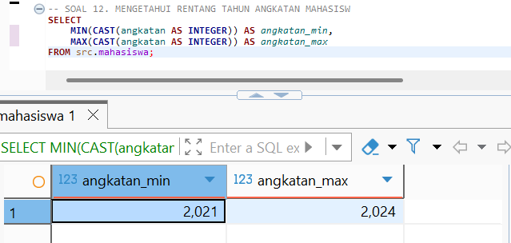


**Interpretasi:** Berdasarkan hasil query, tahun angkatan mahasiswa paling awal adalah 2021 dan paling akhir adalah 2024. Dengan demikian, dataset mencakup empat kelompok angkatan, yaitu 2021, 2022, 2023, dan 2024. Karena kolom `angkatan` pada hasil verifikasi bertipe `integer`, fungsi `MIN` dan `MAX` menghitung rentang tahun secara numerik.


---

## 11. Memeriksa Data Kota Asal yang Kosong

**Query SQL:**

```sql
SELECT COUNT(*) AS missing_kota
FROM src.mahasiswa
WHERE TRIM(COALESCE(kota_asal_raw, '')) = '';
```

**Hasil eksekusi:**

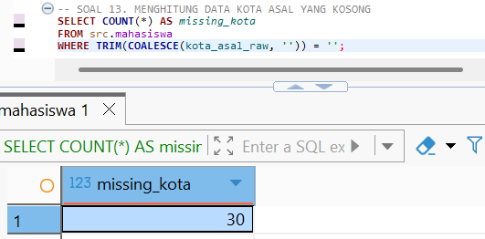


**Interpretasi:** Hasil query menunjukkan bahwa terdapat 30 record mahasiswa yang tidak memiliki informasi kota asal, atau sekitar 1,53% dari total 1.965 baris. Kondisi ini dapat menyebabkan analisis persebaran daerah asal mahasiswa menjadi kurang lengkap karena sebagian data lokasi tidak tersedia. Nilai yang kosong tetap dibiarkan apa adanya karena tahap ini hanya melakukan profiling dan belum mencakup proses pengisian atau perbaikan data.

---

## 12. Menghitung Variasi Label Program Studi pada Mahasiswa

**Query SQL:**

```sql
SELECT COUNT(DISTINCT prodi_raw) AS distinct_prodi_raw
FROM src.mahasiswa;
```

**Hasil eksekusi:**

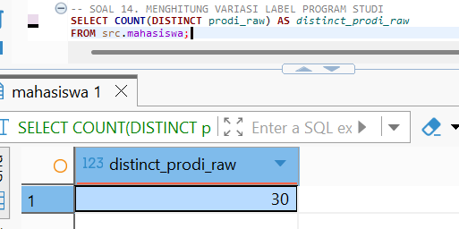


**Interpretasi:** Hasil query menemukan 30 nilai berbeda pada kolom `prodi_raw`, sedangkan tabel referensi `src.program_studi` hanya memuat 6 program studi resmi. Perbedaan jumlah tersebut menunjukkan adanya variasi label program studi pada data mahasiswa, misalnya penggunaan singkatan, perbedaan kapitalisasi, atau bentuk penulisan lainnya. Temuan ini menjadi indikasi awal bahwa label program studi perlu dipetakan ke referensi resmi pada tahap transformasi, tetapi belum diubah pada source.
---

## 13. Menghitung Jumlah Program Studi pada Tabel Referensi

**Query SQL:**

```sql
SELECT COUNT(*) AS canonical_programs
FROM src.program_studi;
```

**Hasil eksekusi:**

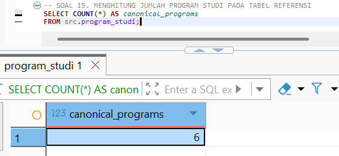


**Perbandingan:**

| Keterangan | Jumlah |
|---|---:|
| Variasi label `prodi_raw` | 30 |
| Record pada `src.program_studi` | 6 |

**Interpretasi:** Tabel referensi `src.program_studi` berisi 6 record program studi yang digunakan sebagai acuan nama program studi resmi. Jika dibandingkan dengan 30 variasi label pada kolom `prodi_raw`, terdapat selisih 24 label. Selisih ini menunjukkan bahwa data mahasiswa memuat beberapa bentuk penulisan selain label resmi, sehingga diperlukan pemetaan label ke program studi yang sesuai pada tahap berikutnya.

---

## 14. Menampilkan Distribusi Label Program Studi Mentah

**Query SQL:**

```sql
SELECT
    prodi_raw,
    COUNT(*) AS jumlah
FROM src.mahasiswa
GROUP BY prodi_raw
ORDER BY prodi_raw;
```

**Hasil eksekusi:**

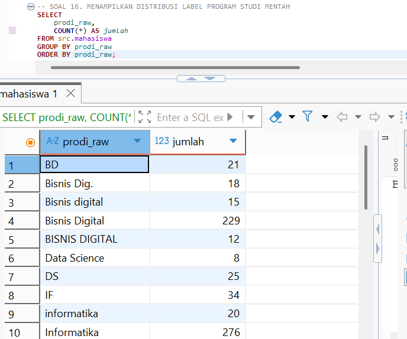

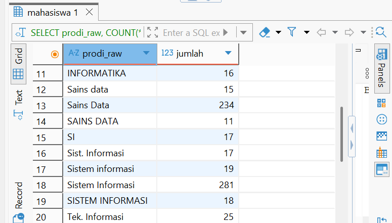

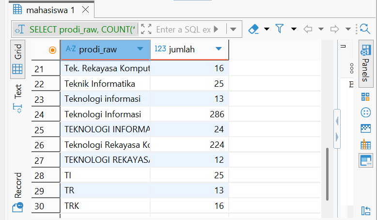


**Interpretasi:** Distribusi menunjukkan bahwa label *Teknologi Informasi* memiliki jumlah terbanyak, yaitu 286 record. Selain enam label yang sama dengan nama program studi pada tabel referensi, terdapat 24 label lain dengan total 435 record atau sekitar 22,1% dari seluruh data mahasiswa. Variasi tersebut terlihat dalam bentuk singkatan, pemendekan nama, dan perbedaan kapitalisasi. Oleh karena itu, label-label tersebut perlu diperiksa dan dipetakan terlebih dahulu sebelum dilakukan standardisasi agar setiap mahasiswa terhubung dengan program studi yang tepat.

---

## 15. Menampilkan Variasi Label Jenis Kelamin

**Query SQL:**

```sql
SELECT
    jk_raw,
    COUNT(*) AS jumlah
FROM src.mahasiswa
GROUP BY jk_raw
ORDER BY jk_raw;
```

**Hasil eksekusi:**

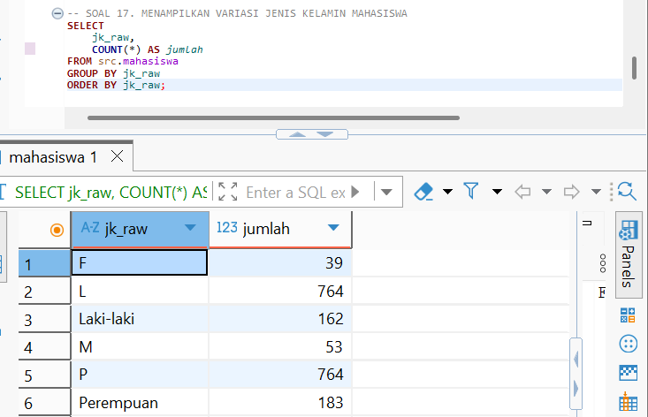


**Interpretasi:**  Hasil pengelompokan menunjukkan terdapat enam label pada kolom `jk_raw`, yaitu `F`, `L`, `Laki-laki`, `M`, `P`, dan `Perempuan`. Keenam label tersebut merepresentasikan dua kategori, yaitu laki-laki dan perempuan, tetapi ditulis dengan bentuk yang berbeda. Jika data langsung dihitung berdasarkan label mentah, jumlah setiap kategori dapat terpisah ke beberapa kelompok. Karena itu, standardisasi label diperlukan pada tahap transformasi berikutnya, bukan pada source raw.

---

## 16. Menampilkan Sampel Record Tabel Mahasiswa

**Query SQL:**

```sql
SELECT *
FROM src.mahasiswa
LIMIT 5;
```

**Hasil eksekusi:**

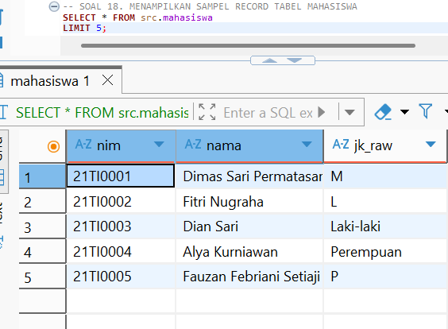

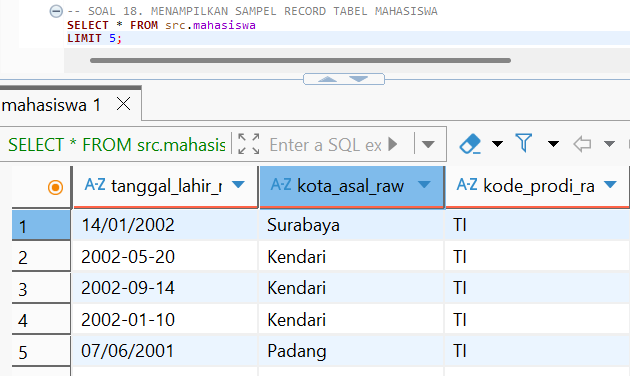

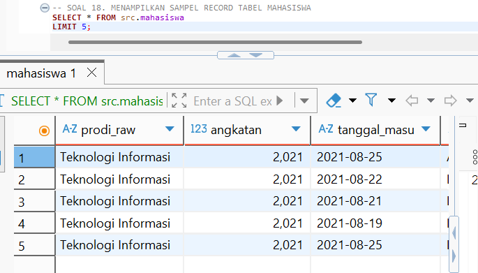

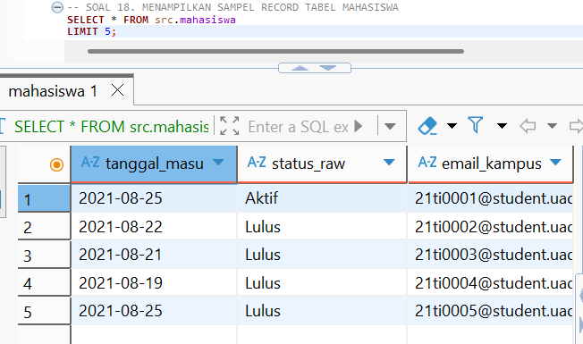


*Lima baris pertama berdasarkan urutan baris pada file sumber (tanpa `ORDER BY`).*

**Interpretasi:** Lima record yang ditampilkan memberikan gambaran awal mengenai isi dan format kolom pada tabel `mahasiswa`. Contohnya, NIM memiliki pola gabungan tahun, kode program studi, dan nomor urut; kolom jenis kelamin menggunakan beberapa variasi label; sedangkan tanggal lahir ditulis dengan format yang berbeda. Meskipun demikian, sampel lima baris belum mewakili keseluruhan 1.965 record. Oleh karena itu, kesimpulan mengenai kualitas data harus didasarkan pada pemeriksaan seluruh record, seperti perhitungan duplikasi, nilai kosong, dan variasi label yang telah dilakukan pada bagian sebelumnya.


---

## 17. Mengidentifikasi Source dengan Jumlah Baris Terbesar

**Query SQL:**

```sql
SELECT 'program_studi' AS source, COUNT(*) AS rows FROM src.program_studi
UNION ALL SELECT 'semester', COUNT(*) FROM src.semester
UNION ALL SELECT 'mahasiswa', COUNT(*) FROM src.mahasiswa
UNION ALL SELECT 'dosen', COUNT(*) FROM src.dosen
UNION ALL SELECT 'mata_kuliah', COUNT(*) FROM src.mata_kuliah
UNION ALL SELECT 'krs', COUNT(*) FROM src.krs
UNION ALL SELECT 'nilai', COUNT(*) FROM src.nilai
UNION ALL SELECT 'aktivitas_lms', COUNT(*) FROM src.aktivitas_lms
UNION ALL SELECT 'pembayaran', COUNT(*) FROM src.pembayaran
UNION ALL SELECT 'kelulusan', COUNT(*) FROM src.kelulusan
ORDER BY rows DESC;
```

**Hasil eksekusi:**

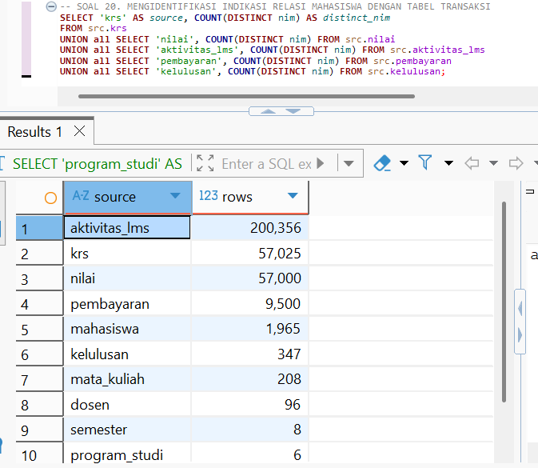


**Source dengan jumlah baris terbanyak:** `aktivitas_lms`

**Jumlah baris:** 200.356

**Interpretasi:** Berdasarkan hasil pengurutan jumlah baris, tabel `aktivitas_lms` merupakan source dengan ukuran terbesar, yaitu 200.356 baris. Jumlah tersebut jauh lebih besar dibandingkan tabel source lainnya karena tabel ini mencatat aktivitas mahasiswa pada Learning Management System (LMS). Ukuran data tersebut perlu diperhatikan dalam perencanaan proses pengolahan berikutnya, terutama untuk menentukan strategi pemrosesan dan kebutuhan optimasi.

---

## 18. Mengidentifikasi Indikasi Relasi Mahasiswa dengan Tabel Transaksi

**Query SQL:**

```sql
SELECT 'krs' AS source,
       COUNT(DISTINCT nim) AS distinct_nim
FROM src.krs
UNION ALL
SELECT 'nilai', COUNT(DISTINCT nim) FROM src.nilai
UNION ALL
SELECT 'aktivitas_lms', COUNT(DISTINCT nim) FROM src.aktivitas_lms
UNION ALL
SELECT 'pembayaran', COUNT(DISTINCT nim) FROM src.pembayaran
UNION ALL
SELECT 'kelulusan', COUNT(DISTINCT nim) FROM src.kelulusan;
```

**Hasil eksekusi:**

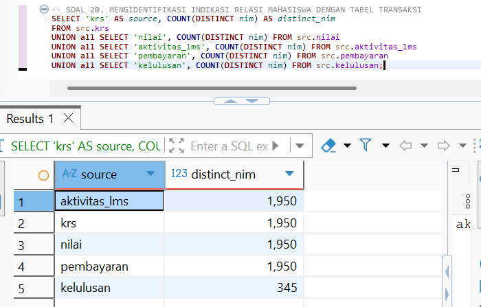


### 18.1 Catatan relasi awal

| Rel ID | Source A | Key A | Source B | Key B | Dugaan hubungan bisnis | Catatan/verifikasi lanjutan |
|---|---|---|---|---|---|---|
| REL01 | `mahasiswa` | `nim` | `krs` | `nim` | 1 mahasiswa : banyak KRS | Uji orphan NIM KRS terhadap mahasiswa |
| REL02 | `mahasiswa` | `nim` | `nilai` | `nim` | 1 mahasiswa : banyak nilai | Uji orphan NIM nilai; cocokkan dengan KRS |
| REL03 | `mahasiswa` | `nim` | `aktivitas_lms` | `nim` | 1 mahasiswa : banyak aktivitas LMS | Uji orphan NIM LMS |
| REL04 | `mahasiswa` | `nim` | `pembayaran` | `nim` | 1 mahasiswa : banyak pembayaran | Uji orphan NIM pembayaran |
| REL05 | `mahasiswa` | `nim` | `kelulusan` | `nim` | 1 mahasiswa : 0/1 outcome kelulusan secara bisnis | Uji duplikasi kelulusan dan orphan NIM |

**Interpretasi:** Kolom `nim` terdapat pada tabel `mahasiswa` serta tabel `krs`, `nilai`, `aktivitas_lms`, `pembayaran`, dan `kelulusan`. Hal ini menunjukkan adanya dugaan hubungan antara data mahasiswa dan data transaksi atau aktivitas. Jumlah NIM unik pada `krs`, `nilai`, `aktivitas_lms`, dan `pembayaran` masing-masing 1.950, sama dengan jumlah NIM unik pada tabel `mahasiswa`, sedangkan tabel `kelulusan` memiliki 345 NIM unik. Perbedaan tersebut dapat terjadi karena tidak semua mahasiswa memiliki catatan kelulusan. Namun, kesamaan nama kolom dan jumlah NIM unik belum membuktikan bahwa seluruh NIM pada tabel terkait benar-benar cocok. Integritas relasi masih perlu diperiksa melalui pengujian orphan menggunakan `LEFT JOIN` pada Unit 1.2.

---

## 19. Ringkasan Hasil Initial Profiling

| No. | Aspek yang diperiksa | Temuan berdasarkan hasil query | Tindak lanjut yang disarankan |
|---:|---|---|---|
| 1 | Kesiapan environment PostgreSQL | Server dan database dapat diakses; versi dan user tercatat | Pertahankan konfigurasi untuk unit berikutnya |
| 2 | Ketersediaan schema dan tabel | Schema `src` dan 10 tabel tersedia | Tidak ada |
| 3 | Keberhasilan impor dataset | 10 file CSV termuat; jumlah baris sesuai acuan | Pertahankan raw data tanpa perubahan |
| 4 | Jumlah baris setiap source | 6 s.d. 200.356 baris; sesuai acuan | Tidak ada |
| 5 | Jumlah kolom setiap source | 5 s.d. 11 kolom | Tidak ada |
| 6 | Keunikan NIM mahasiswa | 1.965 baris vs 1.950 NIM unik; 15 baris berlebih | Selidiki apakah duplikat persis atau historis |
| 7 | Rentang angkatan | 2021 s.d. 2024 | Tidak ada |
| 8 | Kelengkapan kota asal | 30 record kosong (1,53%) | Tentukan penanganan pada ETL |
| 9 | Variasi label program studi | 30 label vs 6 program studi resmi | Susun tabel mapping label ke kode prodi |
| 10 | Variasi label jenis kelamin | 6 label untuk 2 konsep | Standardisasi ke L/P pada tahap transformasi |
| 11 | Ukuran source terbesar | `aktivitas_lms` (200.356 baris) | Rencanakan pemrosesan bertahap |
| 12 | Indikasi relasi antartabel | `nim` muncul di 5 tabel transaksi | Uji integritas referensial pada Unit 1.2 |

---

## 20. Kesimpulan

Source layer pada schema `src` telah siap: schema dan sepuluh tabel berhasil dibuat serta seluruh file CSV UADW v1.0 berhasil dimuat tanpa mengubah nilai raw. Jumlah baris setiap tabel sesuai dengan nilai acuan (dari 6 baris pada `program_studi` hingga 200.356 baris pada `aktivitas_lms`) dan jumlah kolom sesuai definisi source.

Initial profiling pada tabel `mahasiswa` menunjukkan beberapa karakteristik awal: NIM belum terbukti unik (1.965 baris vs 1.950 NIM unik), angkatan mencakup 2021–2024, 30 record tidak memiliki kota asal, terdapat 30 variasi label program studi untuk 6 program studi resmi, dan 6 variasi label untuk 2 konsep jenis kelamin. Kolom `nim` juga muncul pada lima tabel transaksi sehingga terindikasi relasi dengan mahasiswa.

Temuan tersebut hanya dicatat dan tidak diperbaiki pada unit ini. Unit berikutnya perlu memeriksa lebih dalam duplikasi (apakah identik penuh atau historis), kelengkapan, validitas, konsistensi format, dan integritas referensial antartabel sebelum dilakukan cleaning dan standardisasi.
