# LAPORAN MODUL 1 UNIT 1.2

# DATA PROFILING DAN DATA QUALITY ASSESSMENT

---

## Identitas Laporan

Nama       : [Annisa Almaghvirah]  
NIM        : [240306037]  
Program Studi : [Teknologi Informasi]  
Modul      : 1  
Unit       : 1.2  
Tanggal Praktikum : [5 November 2026]  
DBMS       : PostgreSQL  
Database   : [uadw_lab]  
Schema     : `src`
---

## Tujuan Praktikum

Setelah menyelesaikan praktikum ini, mahasiswa diharapkan mampu:

1. Melakukan profiling terhadap struktur dan ukuran dataset akademik.
2. Memeriksa kualitas data berdasarkan aspek *uniqueness*, *completeness*, *validity*, dan *consistency*.
3. Mengidentifikasi indikasi duplikasi pada tabel master maupun transaksi.
4. Memeriksa keterhubungan data antar-tabel (*referential integrity*).
5. Menyusun interpretasi berdasarkan hasil eksekusi query SQL tanpa langsung mengubah data sumber.

## Ketentuan Pengerjaan

1. Menggunakan PostgreSQL dan schema `src` dengan dataset UADW v1.0.
2. Data pada source layer dipertahankan dalam kondisi asli (*raw data*).
3. Praktikum berfokus pada pemeriksaan: tidak ada `UPDATE`, `DELETE`, deduplikasi, atau standardisasi pada tabel `src`.
4. Seluruh query tersimpan pada file `SQL/modul_1_unit_1.2.sql` dan dijalankan melalui SQL Editor DBeaver.
5. Screenshot hasil eksekusi disisipkan pada bagian bukti masing-masing soal.

---

# 1. Menyiapkan dan Memverifikasi Environment Praktikum

### 1.1 Memeriksa versi PostgreSQL

```sql
SELECT version();
```

**Hasil eksekusi:**


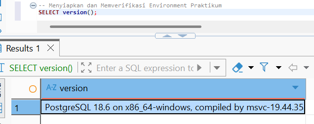


### 1.2 Memeriksa database dan user aktif

```sql
SELECT
    current_database() AS database_aktif,
    current_user      AS user_aktif;
```

**Hasil eksekusi:**


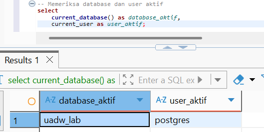


### 1.3 Memastikan schema `src` tersedia

```sql
SELECT schema_name
FROM information_schema.schemata
WHERE schema_name = 'src';
```

**Hasil eksekusi:**


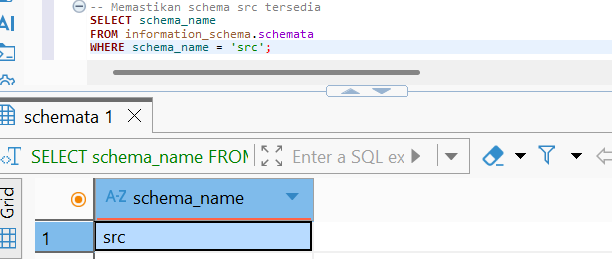


---

# 2. Profiling Struktur dan Ukuran Dataset

## 2.1 Soal 1 — Menghitung jumlah record setiap tabel

**Tujuan pemeriksaan**  
Mengetahui jumlah record pada sepuluh tabel sumber database akademik.

**Query SQL**

```sql
SELECT 'program_studi' AS nama_dataset, COUNT(*) AS jumlah_record FROM src.program_studi
UNION ALL SELECT 'semester', COUNT(*) FROM src.semester
UNION ALL SELECT 'mahasiswa', COUNT(*) FROM src.mahasiswa
UNION ALL SELECT 'dosen', COUNT(*) FROM src.dosen
UNION ALL SELECT 'mata_kuliah', COUNT(*) FROM src.mata_kuliah
UNION ALL SELECT 'krs', COUNT(*) FROM src.krs
UNION ALL SELECT 'nilai', COUNT(*) FROM src.nilai
UNION ALL SELECT 'aktivitas_lms', COUNT(*) FROM src.aktivitas_lms
UNION ALL SELECT 'pembayaran', COUNT(*) FROM src.pembayaran
UNION ALL SELECT 'kelulusan', COUNT(*) FROM src.kelulusan;
```

**Hasil eksekusi**

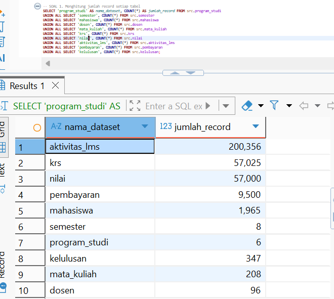


| Dataset | Jumlah Record |
|---|---:|
| `program_studi` | 6 |
| `semester` | 8 |
| `mahasiswa` | 1.965 |
| `dosen` | 96 |
| `mata_kuliah` | 208 |
| `krs` | 57.025 |
| `nilai` | 57.000 |
| `aktivitas_lms` | 200.356 |
| `pembayaran` | 9.500 |
| `kelulusan` | 347 |

**Interpretasi**

Tabel terbesar adalah `aktivitas_lms` (200.356 record) yang merupakan log aktivitas LMS, disusul `krs` (57.025) dan `nilai` (57.000). Tabel terkecil adalah `program_studi` (6 record) dan `semester` (8 record) yang berperan sebagai tabel referensi. Pola ini wajar: tabel transaksi berukuran jauh lebih besar daripada tabel master/referensi. Perbedaan `krs` (57.025) dengan `nilai` (57.000) sebanyak 25 record sudah menjadi petunjuk awal adanya duplikasi pada KRS (dibuktikan pada Soal 13–15).

## 2.2 Soal 2 — Menghitung jumlah kolom setiap tabel

**Tujuan pemeriksaan**  
Mengetahui jumlah kolom pada setiap tabel dalam schema `src`.

**Query SQL**

```sql
SELECT table_name AS nama_tabel, COUNT(*) AS jumlah_kolom
FROM information_schema.columns
WHERE table_schema = 'src'
GROUP BY table_name
ORDER BY table_name ASC;
```

**Hasil eksekusi**

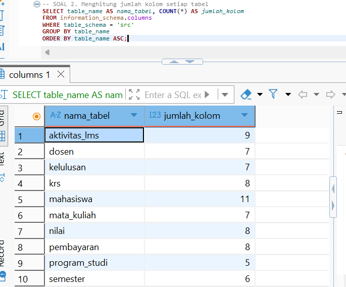


**Interpretasi**

Tabel dengan kolom terbanyak adalah `mahasiswa` (11 kolom) karena memuat banyak atribut deskriptif mentah (`*_raw`), sedangkan yang paling sedikit adalah `program_studi` (5 kolom). Tabel transaksi memiliki 7–9 kolom. Jumlah kolom ini menjadi acuan bahwa struktur tabel hasil impor sesuai dengan definisi pada bahan praktikum.

---

# 3. Profiling Tabel Mahasiswa

## 3.1 Soal 3 — Mengukur keunikan NIM

**Tujuan pemeriksaan**  
Mengetahui jumlah record mahasiswa, jumlah NIM unik, dan indikasi kelebihan record berdasarkan NIM.

**Query SQL**

```sql
SELECT
    COUNT(*) AS jumlah_seluruh_record,
    COUNT(DISTINCT nim) AS jumlah_nim_unik,
    COUNT(*) - COUNT(DISTINCT nim) AS indikasi_kelebihan_record_duplikat
FROM src.mahasiswa;
```

**Hasil eksekusi**

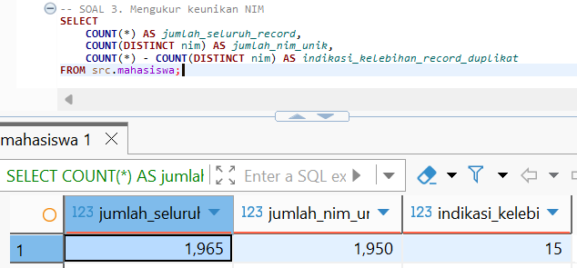


**Interpretasi**

Tabel `mahasiswa` memiliki 1.965 record tetapi hanya 1.950 NIM yang berbeda, sehingga terdapat 15 record berlebih. Artinya NIM **belum terbukti unik** dan terdapat indikasi duplikasi. Namun, hasil ini belum cukup untuk memutuskan penghapusan; perlu diperiksa apakah baris-baris tersebut identik penuh atau merupakan data historis (lihat Soal 4).

## 3.2 Soal 4 — Mengidentifikasi NIM duplikat

**Tujuan pemeriksaan**  
Menampilkan NIM yang muncul lebih dari satu kali beserta jumlah kemunculannya.

**Query SQL**

```sql
SELECT nim, COUNT(*) AS jumlah_kemunculan
FROM src.mahasiswa
GROUP BY nim
HAVING COUNT(*) > 1
ORDER BY jumlah_kemunculan DESC, nim ASC;
```

**Hasil eksekusi**

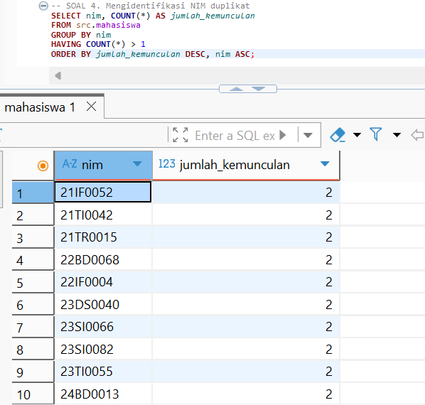

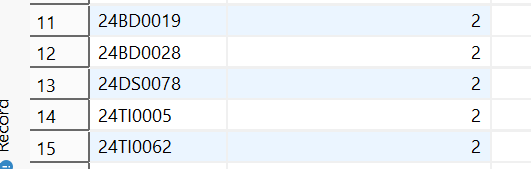


Hasil query menampilkan **15 baris** (15 NIM), masing-masing muncul 2 kali.

| nim | jumlah_kemunculan |
|---|---:|
| 21IF0052 | 2 |
| 21TI0042 | 2 |
| 21TR0015 | 2 |
| 22BD0068 | 2 |
| 22IF0004 | 2 |
| 23DS0040 | 2 |
| 23SI0066 | 2 |
| 23SI0082 | 2 |
| 23TI0055 | 2 |
| 24BD0013 | 2 |
| 24BD0019 | 2 |
| 24BD0028 | 2 |
| 24DS0078 | 2 |
| 24TI0005 | 2 |
| 24TI0062 | 2 |

**Interpretasi**

- Jumlah kelompok NIM duplikat: **15**
- Jumlah kemunculan tertinggi: **2**
- Catatan: pemeriksaan lanjutan pada profiling menunjukkan seluruh atribut pada baris duplikat sama persis (tidak ada kelompok dengan atribut berbeda), sehingga lebih mengarah pada *exact duplicate* daripada data historis. Meskipun demikian, tindakan penanganan (deduplikasi) tidak dilakukan pada Unit ini dan baru dirancang pada tahap cleaning.

## 3.3 Soal 5 — Memeriksa kelengkapan kota asal mahasiswa

**Tujuan pemeriksaan**  
Menghitung jumlah record dengan `kota_asal_raw` kosong, `NULL`, atau hanya berisi spasi.

**Query SQL**

```sql
SELECT COUNT(*) AS missing_kota
FROM src.mahasiswa
WHERE kota_asal_raw IS NULL
   OR TRIM(kota_asal_raw) = '';
```

**Hasil eksekusi**

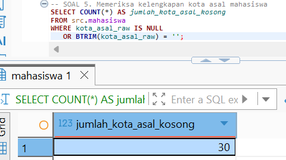


| Missing Kota Asal |
|---:|
| 30 |

**Interpretasi**

Terdapat **30 record** (30 / 1.965 = **1,53%**) tanpa informasi kota asal. Proporsinya kecil, tetapi analisis sebaran daerah asal mahasiswa menjadi tidak lengkap. Data tidak diimputasi pada tahap profiling; penanganan (misalnya kategori *Unknown*) ditentukan pada tahap ETL.

## 3.4 Soal 6 — Distribusi mahasiswa berdasarkan program studi (prodi_raw)

**Tujuan pemeriksaan**  
Menampilkan frekuensi setiap label pada kolom `prodi_raw`.

**Query SQL**

```sql
SELECT
    prodi_raw,
    COUNT(*) AS frekuensi
FROM src.mahasiswa
GROUP BY prodi_raw
ORDER BY frekuensi DESC, prodi_raw;
```

**Hasil eksekusi**

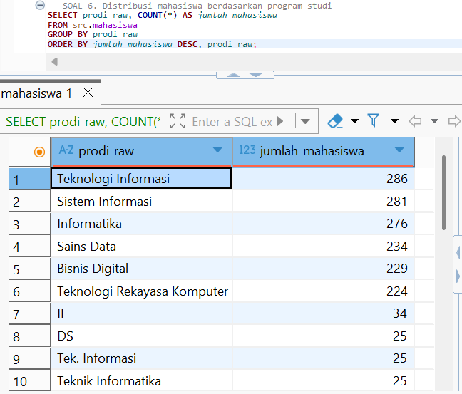

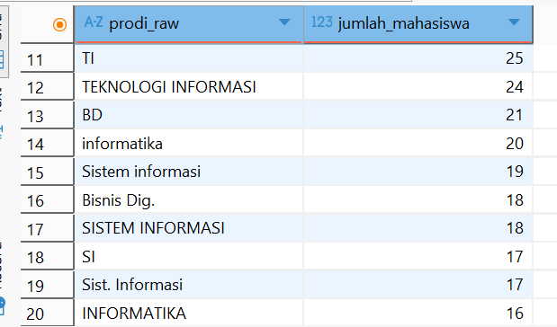

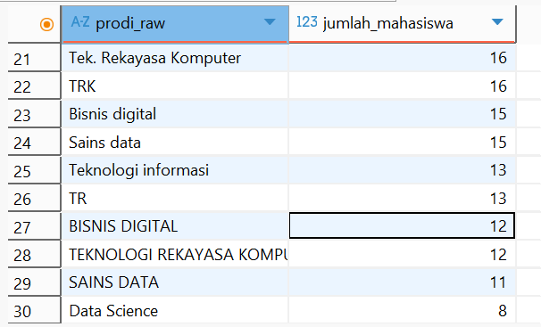


| prodi_raw | frekuensi |
|---|---:|
| Teknologi Informasi | 286 |
| Sistem Informasi | 281 |
| Informatika | 276 |
| Sains Data | 234 |
| Bisnis Digital | 229 |
| Teknologi Rekayasa Komputer | 224 |
| IF | 34 |
| DS | 25 |
| TI | 25 |
| Tek. Informasi | 25 |
| Teknik Informatika | 25 |
| TEKNOLOGI INFORMASI | 24 |
| BD | 21 |
| informatika | 20 |
| Sistem informasi | 19 |
| Bisnis Dig. | 18 |
| SISTEM INFORMASI | 18 |
| SI | 17 |
| Sist. Informasi | 17 |
| INFORMATIKA | 16 |
| TRK | 16 |
| Tek. Rekayasa Komputer | 16 |
| Bisnis digital | 15 |
| Sains data | 15 |
| TR | 13 |
| Teknologi informasi | 13 |
| BISNIS DIGITAL | 12 |
| TEKNOLOGI REKAYASA KOMPUTER | 12 |
| SAINS DATA | 11 |
| Data Science | 8 |

**Interpretasi**

Terdapat 30 label berbeda untuk hanya 6 program studi. Enam label canonical mencakup 1.530 record, sedangkan 435 record (22,1%) tersebar pada 24 label non-canonical. Label paling banyak adalah *Teknologi Informasi* (286) dan paling sedikit dari yang tercatat adalah *Data Science* (8). Variasi berupa singkatan (IF, TI, DS, BD), penulisan lain (Tek. Informasi, Teknik Informatika, Data Science), dan kapitalisasi (TEKNOLOGI INFORMASI) kemungkinan merujuk program studi yang sama.

## 3.5 Soal 7 — Menghitung variasi penulisan program studi

**Tujuan pemeriksaan**  
Menghitung jumlah nilai berbeda pada kolom `prodi_raw`.

**Query SQL**

```sql
SELECT COUNT(DISTINCT prodi_raw) AS distinct_raw_prodi
FROM src.mahasiswa;
```

**Hasil eksekusi**

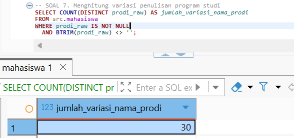


| Jumlah Variasi `prodi_raw` |
|---:|
| 30 |

**Interpretasi**

Ditemukan **30 variasi** penulisan, padahal tabel referensi `program_studi` hanya memuat **6** program studi resmi. Selisih 24 label menunjukkan adanya variasi representasi (inkonsistensi) pada data mahasiswa yang perlu dipetakan (mapping) pada tahap standardisasi.

## 3.6 Soal 8 — Distribusi jenis kelamin (jk_raw)

**Tujuan pemeriksaan**  
Menampilkan setiap nilai `jk_raw` dan frekuensi kemunculannya.

**Query SQL**

```sql
SELECT
    jk_raw,
    COUNT(*) AS frekuensi
FROM src.mahasiswa
GROUP BY jk_raw
ORDER BY frekuensi DESC, jk_raw;
```

**Hasil eksekusi**

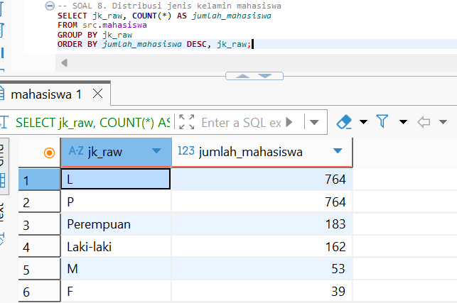


| jk_raw | frekuensi |
|---|---:|
| L | 764 |
| P | 764 |
| Perempuan | 183 |
| Laki-laki | 162 |
| M | 53 |
| F | 39 |

**Interpretasi**

Terdapat 6 kode untuk 2 konsep jenis kelamin: `L`, `Laki-laki`, `M` kemungkinan merujuk laki-laki, sedangkan `P`, `Perempuan`, `F` kemungkinan merujuk perempuan. Sebanyak 437 record (22,2%) tidak memakai kode standar L/P. Diperlukan standardisasi pada tahap berikutnya, namun tidak dilakukan pada tabel raw.

## 3.7 Soal 9 — Distribusi status mahasiswa (status_raw)

**Tujuan pemeriksaan**  
Menampilkan variasi nilai `status_raw` dan jumlah record pada setiap status.

**Query SQL**

```sql
SELECT
    status_raw,
    COUNT(*) AS frekuensi
FROM src.mahasiswa
GROUP BY status_raw
ORDER BY frekuensi DESC, status_raw;
```

**Hasil eksekusi**

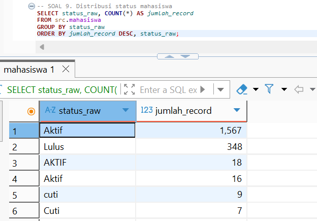


| status_raw | frekuensi |
|---|---:|
| Aktif | 1567 |
| Lulus | 348 |
| AKTIF | 18 |
| "Aktif " (diakhiri spasi) | 16 |
| cuti | 9 |
| Cuti | 7 |

**Interpretasi**

Ditemukan 6 variasi untuk 3 status bisnis (Aktif, Lulus, Cuti). Variasi muncul karena kapitalisasi (`AKTIF`, `cuti`) dan spasi tambahan (`"Aktif "`). Sebanyak 43 record perlu `TRIM`/penyeragaman kapitalisasi agar kategori tidak terpecah. Tidak ditemukan status kosong.

## 3.8 Soal 10 — Distribusi kode program studi (kode_prodi_raw)

**Tujuan pemeriksaan**  
Menampilkan nilai `kode_prodi_raw` dan frekuensi kemunculannya.

**Query SQL**

```sql
SELECT
    kode_prodi_raw,
    COUNT(*) AS frekuensi
FROM src.mahasiswa
GROUP BY kode_prodi_raw
ORDER BY frekuensi DESC, kode_prodi_raw;
```

**Hasil eksekusi**

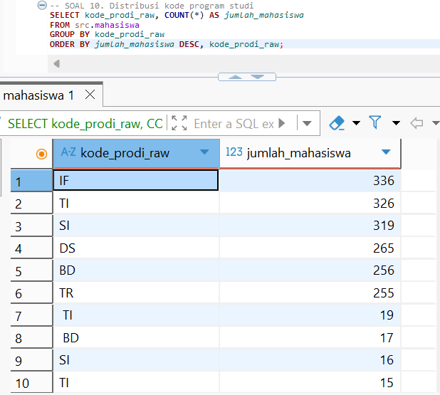

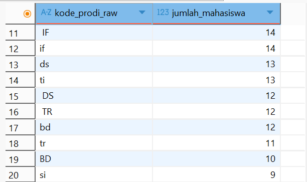

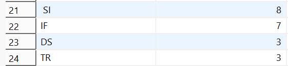


| kode_prodi_raw | frekuensi |
|---|---:|
| IF | 336 |
| TI | 326 |
| SI | 319 |
| DS | 265 |
| BD | 256 |
| TR | 255 |
| ' TI' | 19 |
| ' BD' | 17 |
| 'SI ' | 16 |
| 'TI ' | 15 |
| ' IF' | 14 |
| if | 14 |
| ds | 13 |
| ti | 13 |
| ' DS' | 12 |
| ' TR' | 12 |
| bd | 12 |
| tr | 11 |
| 'BD ' | 10 |
| si | 9 |
| ' SI' | 8 |
| 'IF ' | 7 |
| 'DS ' | 3 |
| 'TR ' | 3 |

Nilai yang ditulis dengan tanda kutip memiliki spasi di depan/belakang.

**Interpretasi**

Terdapat 24 variasi untuk 6 kode program studi. Kode paling banyak adalah `IF` (336). Sebanyak 208 record tidak sama persis dengan `program_studi.kode_prodi` karena spasi di depan/belakang (136 record) atau huruf kecil (72 record). Setelah `TRIM` + `UPPER`, seluruh kode cocok dan sesuai dengan kode pada NIM.

## 3.9 Soal 11 — Nama program studi tidak sesuai standar

**Tujuan pemeriksaan**  
Menghitung record mahasiswa dengan `prodi_raw` yang tidak cocok persis dengan `program_studi.nama_prodi`.

**Query SQL**

```sql
SELECT COUNT(*) AS non_standard_prodi_rows
FROM src.mahasiswa m
LEFT JOIN src.program_studi p
       ON m.prodi_raw = p.nama_prodi
WHERE p.nama_prodi IS NULL;
```

**Hasil eksekusi**

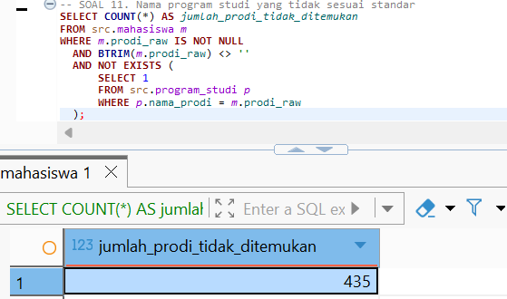


| Non-standard Prodi Rows |
|---:|
| 435 |

**Interpretasi**

Sebanyak **435 record** (22,1%) memiliki `prodi_raw` yang tidak cocok persis dengan nama program studi resmi. Penyebab yang mungkin: singkatan, perbedaan kapitalisasi, spasi, atau penulisan nama lain. Kecocokan persis hanya membuktikan ketidaksamaan teks; penyebab spesifik tiap label perlu diperiksa lebih lanjut sebelum dibuat tabel mapping.

## 3.10 Soal 12 — Variasi format tanggal masuk

**Tujuan pemeriksaan**  
Mengelompokkan `tanggal_masuk_raw` berdasarkan format `YYYY-MM-DD`, `DD/MM/YYYY`, `DD-Mon-YYYY`, dan `OTHER`.

**Query SQL**

```sql
WITH klasifikasi AS (
    SELECT
        CASE
            WHEN tanggal_masuk_raw ~ '^\d{4}-\d{2}-\d{2}$'        THEN 'YYYY-MM-DD'
            WHEN tanggal_masuk_raw ~ '^\d{2}/\d{2}/\d{4}$'        THEN 'DD/MM/YYYY'
            WHEN tanggal_masuk_raw ~ '^\d{2}-[A-Za-z]{3}-\d{4}$'   THEN 'DD-Mon-YYYY'
            ELSE 'OTHER'
        END AS format_tanggal
    FROM src.mahasiswa
)
SELECT
    f.format_tanggal,
    COUNT(k.format_tanggal) AS jumlah_record
FROM (VALUES ('YYYY-MM-DD'), ('DD/MM/YYYY'), ('DD-Mon-YYYY'), ('OTHER')) AS f(format_tanggal)
LEFT JOIN klasifikasi k ON k.format_tanggal = f.format_tanggal
GROUP BY f.format_tanggal
ORDER BY jumlah_record DESC;
```

**Hasil eksekusi**

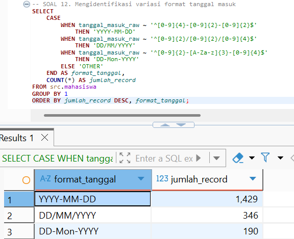


| Format Tanggal | Jumlah Record |
|---|---:|
| `YYYY-MM-DD` | 1.429 |
| `DD/MM/YYYY` | 346 |
| `DD-Mon-YYYY` | 190 |
| `OTHER` | 0 |

**Interpretasi**

Format dominan adalah `YYYY-MM-DD` (1.429 record, 72,7%). Dua format lain masih ditemukan (346 dan 190 record), sehingga total sekitar 27% record bukan format ISO. Kategori `OTHER` bernilai 0 artinya tidak ada format di luar tiga pola yang diperkirakan. Perlu dicatat bahwa kecocokan pola belum membuktikan tanggal valid secara kalender, dan format `DD/MM/YYYY` berpotensi ambigu dengan `MM/DD/YYYY`.

---

# 4. Profiling Tabel KRS

## 4.1 Soal 13 — Jumlah record KRS vs krs_id unik

**Tujuan pemeriksaan**  
Membandingkan jumlah seluruh record KRS dengan jumlah `krs_id` yang unik.

**Query SQL**

```sql
SELECT
    COUNT(*)                AS raw_rows,
    COUNT(DISTINCT krs_id)  AS distinct_krs_id
FROM src.krs;
```

**Hasil eksekusi**

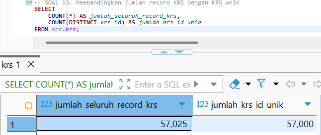


| Raw Rows | Distinct KRS ID |
|---:|---:|
| 57.025 | 57.000 |

**Interpretasi**

Jumlah record (57.025) lebih banyak daripada `krs_id` unik (57.000), selisih **25 record**. Ini menunjukkan indikasi duplikasi berdasarkan `krs_id`.

## 4.2 Soal 14 — Duplikasi pengambilan mata kuliah (nim, kode_mk, semester_id)

**Tujuan pemeriksaan**  
Menemukan kombinasi `nim`, `kode_mk`, dan `semester_id` yang muncul lebih dari satu kali pada tabel KRS.

**Query SQL**

```sql
SELECT
    nim,
    kode_mk,
    semester_id,
    COUNT(*) AS jumlah
FROM src.krs
GROUP BY nim, kode_mk, semester_id
HAVING COUNT(*) > 1
ORDER BY jumlah DESC, nim, kode_mk, semester_id;
```

**Hasil eksekusi**

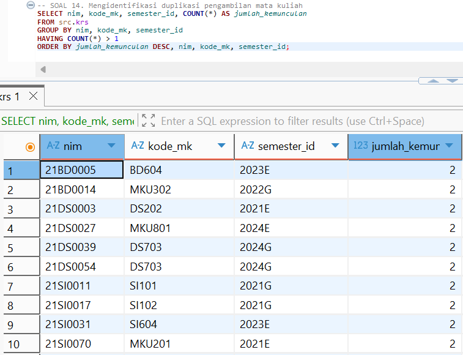

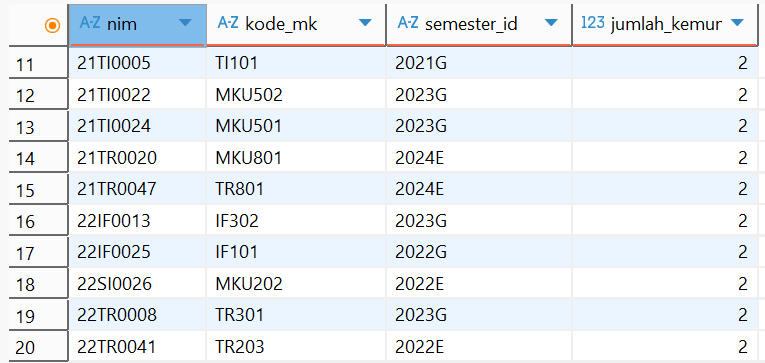

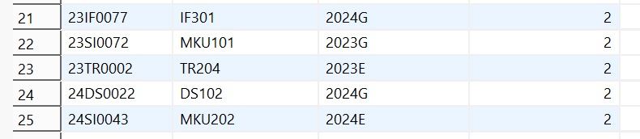


Hasil query menampilkan **25 kombinasi** `nim + kode_mk + semester_id`, masing-masing dengan `jumlah` = 2.

| nim | kode_mk | semester_id | jumlah |
|---|---|---|---:|
| 21BD0005 | BD604 | 2023E | 2 |
| 21BD0014 | MKU302 | 2022G | 2 |
| 21DS0003 | DS202 | 2021E | 2 |
| 21DS0027 | MKU801 | 2024E | 2 |
| 21DS0039 | DS703 | 2024G | 2 |
| 21DS0054 | DS703 | 2024G | 2 |
| 21SI0011 | SI101 | 2021G | 2 |
| 21SI0017 | SI102 | 2021G | 2 |
| 21SI0031 | SI604 | 2023E | 2 |
| 21SI0070 | MKU201 | 2021E | 2 |
| 21TI0005 | TI101 | 2021G | 2 |
| 21TI0022 | MKU502 | 2023G | 2 |
| 21TI0024 | MKU501 | 2023G | 2 |
| 21TR0020 | MKU801 | 2024E | 2 |
| 21TR0047 | TR801 | 2024E | 2 |
| 22IF0013 | IF302 | 2023G | 2 |
| 22IF0025 | IF101 | 2022G | 2 |
| 22SI0026 | MKU202 | 2022E | 2 |
| 22TR0008 | TR301 | 2023G | 2 |
| 22TR0041 | TR203 | 2022E | 2 |
| 23IF0077 | IF301 | 2024G | 2 |
| 23SI0072 | MKU101 | 2023G | 2 |
| 23TR0002 | TR204 | 2023E | 2 |
| 24DS0022 | DS102 | 2024G | 2 |
| 24SI0043 | MKU202 | 2024E | 2 |

**Interpretasi**

- Jumlah kombinasi yang terindikasi duplikat: **25**
- Jumlah kemunculan tertinggi untuk satu kombinasi: **2**
- Catatan: 25 baris tersebut identik penuh (termasuk `krs_id`), sehingga lebih mengarah pada duplikat persis daripada pengambilan di kelas berbeda atau riwayat perubahan status. Dampaknya: peserta kelas dan beban SKS terhitung ganda. Penghapusan tidak dilakukan pada unit ini.

## 4.3 Soal 15 — Kelebihan record KRS akibat duplikasi

**Tujuan pemeriksaan**  
Menghitung total record yang melebihi satu record pada setiap kelompok duplikat.

**Query SQL**

```sql
SELECT COALESCE(SUM(jumlah - 1), 0) AS excess_duplicate_krs
FROM (
    SELECT COUNT(*) AS jumlah
    FROM src.krs
    GROUP BY nim, kode_mk, semester_id
    HAVING COUNT(*) > 1
) AS t;
```

**Hasil eksekusi**

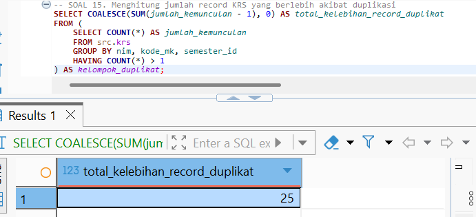


| Excess Duplicate KRS |
|---:|
| 25 |

**Interpretasi**

Total kelebihan record KRS adalah **25**. Karena setiap kelompok duplikat hanya muncul 2 kali (25 kelompok × (2 − 1)), jumlah kelebihan record kebetulan sama dengan jumlah kelompok. Angka ini juga sama dengan selisih 57.025 − 57.000 pada Soal 13, sehingga hasil kedua pemeriksaan konsisten.

---

# 5. Profiling Tabel Nilai

## 5.1 Soal 16 — Nilai angka kosong

**Tujuan pemeriksaan**  
Menghitung record dengan `nilai_angka` kosong, `NULL`, atau hanya berisi spasi.

**Query SQL**

```sql
SELECT COUNT(*) AS missing_nilai_angka
FROM src.nilai
WHERE nilai_angka IS NULL
   OR TRIM(nilai_angka::text) = '';
```

**Hasil eksekusi**

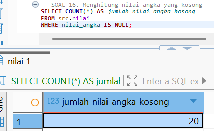


| Missing Nilai Angka |
|---:|
| 20 |

**Interpretasi**

Terdapat **20 record** (0,035% dari 57.000) tanpa nilai angka; baris yang sama juga tidak memiliki `nilai_huruf`. Rata-rata nilai, pass rate, dan IPK dapat bias bila baris ini ikut dihitung, sehingga perlu dikeluarkan dari perhitungan KPI atau ditandai belum dinilai.

## 5.2 Soal 17 — Nilai angka di luar rentang 0-100

**Tujuan pemeriksaan**  
Menghitung nilai angka di luar rentang 0–100 (nilai kosong tidak dihitung).

**Query SQL**

```sql
SELECT COUNT(*) AS invalid_nilai_angka
FROM src.nilai
WHERE NULLIF(TRIM(nilai_angka::text), '') IS NOT NULL
  AND (NULLIF(TRIM(nilai_angka::text), '')::numeric < 0
    OR NULLIF(TRIM(nilai_angka::text), '')::numeric > 100);
```

**Hasil eksekusi**

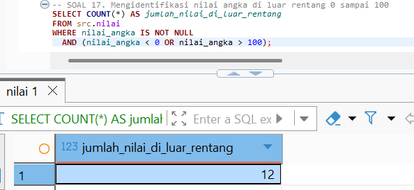


| Invalid Nilai Angka |
|---:|
| 12 |

**Interpretasi**

Ditemukan **12 record** di luar rentang 0–100: 6 bernilai negatif (nilai minimum −18) dan 6 bernilai lebih dari 100 (nilai maksimum 106). Contoh: `NIL0000320` = 105,0 dan `NIL0032132` = −18,0. Nilai ini melanggar aturan domain dan dapat merusak rata-rata serta pass rate.

## 5.3 Soal 18 — Statistik deskriptif nilai valid

**Tujuan pemeriksaan**  
Menghitung jumlah nilai valid, minimum, maksimum, dan rata-rata untuk nilai angka dalam rentang 0–100.

**Query SQL**

```sql
WITH nilai_valid AS (
    SELECT NULLIF(TRIM(nilai_angka::text), '')::numeric AS angka
    FROM src.nilai
)
SELECT
    COUNT(*)                AS valid_rows,
    MIN(angka)              AS nilai_minimum,
    MAX(angka)              AS nilai_maksimum,
    ROUND(AVG(angka), 2)    AS nilai_rata_rata
FROM nilai_valid
WHERE angka BETWEEN 0 AND 100;
```

**Hasil eksekusi**

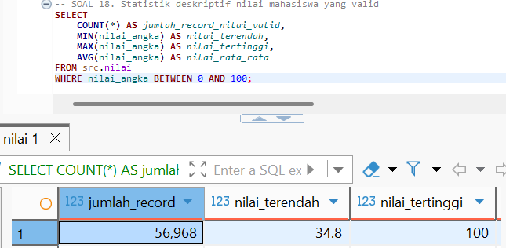

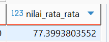


| Valid Rows | Minimum | Maksimum | Rata-rata |
|---:|---:|---:|---:|
| 56.968 | 34,8 | 100,0 | 77,40 |

Jumlah valid = 57.000 − 20 (kosong) − 12 (di luar rentang 0–100) = 56.968. Sebagai pembanding, tanpa filter rentang nilai berkisar −18 sampai 106 (rata-rata 77,39) sehingga outlier memperlebar rentang.

**Interpretasi**

Dari 56.968 nilai valid, nilai terendah adalah 34,8 dan tertinggi 100,0 dengan rata-rata 77,40. Rata-rata yang tinggi dan rentang minimum 34,8 menunjukkan sebagian besar mahasiswa memperoleh nilai di atas batas lulus 60. Interpretasi bersifat deskriptif saja dan tidak menyimpulkan kualitas pembelajaran. Rata-rata tanpa filter (77,39) hampir sama dengan rata-rata valid karena jumlah outlier sangat sedikit (12 baris), tetapi outlier tetap memperlebar min/maks.

## 5.4 Soal 19 — Konsistensi nilai angka dan nilai huruf

**Tujuan pemeriksaan**  
Menghitung record dengan ketidaksesuaian antara `nilai_angka` dan `nilai_huruf` berdasarkan aturan konversi pada soal.

**Query SQL**

```sql
WITH nilai_valid AS (
    SELECT
        nilai_id,
        NULLIF(TRIM(nilai_angka::text), '')::numeric AS angka,
        TRIM(nilai_huruf) AS huruf
    FROM src.nilai
)
SELECT COUNT(*) AS letter_mismatch
FROM nilai_valid
WHERE angka BETWEEN 0 AND 100
  AND huruf IS DISTINCT FROM CASE
        WHEN angka >= 85 THEN 'A'
        WHEN angka >= 80 THEN 'AB'
        WHEN angka >= 75 THEN 'B'
        WHEN angka >= 70 THEN 'BC'
        WHEN angka >= 60 THEN 'C'
        WHEN angka >= 50 THEN 'D'
        ELSE 'E'
      END;
```

**Hasil eksekusi**

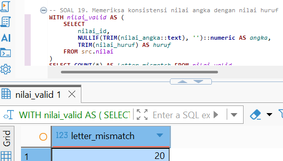


| Letter Mismatch |
|---:|
| 20 |

**Interpretasi**

Ditemukan **20 record** yang nilai hurufnya tidak sesuai dengan hasil konversi nilai angka (hanya nilai valid yang diperiksa). Contoh: `NIL0004118` bernilai 68,2 tetapi tercatat D (seharusnya C), dan `NIL0009299` bernilai 82,8 tercatat B (seharusnya AB). Record ini perlu ditelusuri lebih lanjut untuk menentukan kolom mana yang otoritatif.

## 5.5 Soal 20 — Konsistensi nilai angka dan status kelulusan

**Tujuan pemeriksaan**  
Menghitung record dengan ketidaksesuaian antara `nilai_angka` dan `status_lulus` (≥ 60 = Lulus, < 60 = Tidak Lulus).

**Query SQL**

```sql
WITH nilai_valid AS (
    SELECT
        NULLIF(TRIM(nilai_angka::text), '')::numeric AS angka,
        TRIM(status_lulus) AS status_lulus
    FROM src.nilai
)
SELECT COUNT(*) AS status_mismatch
FROM nilai_valid
WHERE angka BETWEEN 0 AND 100
  AND ( (angka >= 60 AND status_lulus IS DISTINCT FROM 'Lulus')
     OR (angka <  60 AND status_lulus IS DISTINCT FROM 'Tidak Lulus') );
```

**Hasil eksekusi**

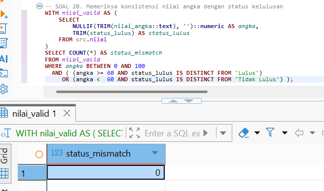


| Status Mismatch |
|---:|
| 0 |

Sebagai pembanding, pemeriksaan **nilai_huruf vs status_lulus** pada profiling awal menemukan 17 record tidak konsisten. Pemeriksaan tersebut berbasis huruf sehingga berbeda dengan soal ini yang berbasis nilai angka.

**Interpretasi**

Tidak ditemukan ketidaksesuaian: seluruh 56.968 nilai valid sudah sesuai aturan (≥ 60 berstatus Lulus dan < 60 berstatus Tidak Lulus). Artinya `status_lulus` konsisten dengan `nilai_angka` pada data valid, sehingga 17 ketidakkonsistenan pada pemeriksaan huruf vs status kemungkinan bersumber dari kolom `nilai_huruf` (atau dari nilai di luar rentang yang dikecualikan di sini) dan perlu ditelusuri lebih lanjut. Hasil 0 menunjukkan tidak ada masalah pada pemeriksaan ini, tetapi tidak berarti seluruh kolom nilai bebas masalah.

## 5.6 Soal 21 — Duplikasi record nilai

**Tujuan pemeriksaan**  
Menampilkan kombinasi `nim`, `kode_mk`, `semester_id` yang tercatat lebih dari satu kali pada tabel nilai.

**Query SQL**

```sql
SELECT
    nim,
    kode_mk,
    semester_id,
    COUNT(*) AS jumlah
FROM src.nilai
GROUP BY nim, kode_mk, semester_id
HAVING COUNT(*) > 1
ORDER BY jumlah DESC, nim, kode_mk, semester_id;
```

**Hasil eksekusi**

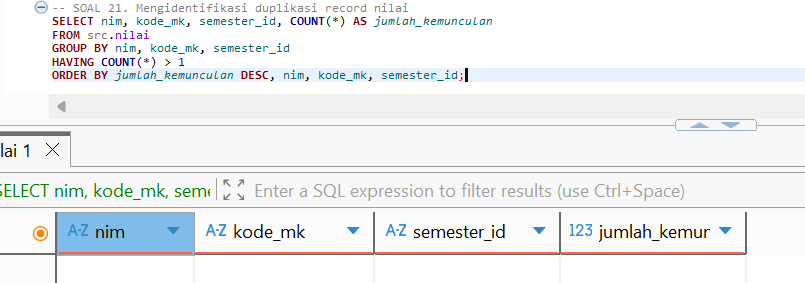


Query menghasilkan **0 baris** (tidak ada kombinasi yang muncul lebih dari satu kali).

**Interpretasi**

Tidak ditemukan duplikasi pada tabel `nilai`: 57.000 record dengan 57.000 `nilai_id` unik, dan kombinasi `nim + kode_mk + semester_id` juga unik. Hasil nol tetap dicatat sebagai bukti bahwa key kandidat valid dan tidak ada indikasi nilai revisi ganda.

---

# 6. Pemeriksaan Referential Integrity pada KRS dan Nilai

## 6.1 Soal 22 — NIM KRS tidak terdaftar di mahasiswa

**Tujuan pemeriksaan**  
Menghitung record yang NIM pada tabel KRS tidak ditemukan pada tabel referensinya.

**Query SQL**

```sql
SELECT COUNT(*) AS krs_nim_tidak_terdaftar
FROM src.krs k
LEFT JOIN src.mahasiswa m ON k.nim = m.nim
WHERE m.nim IS NULL;
```

**Hasil eksekusi**

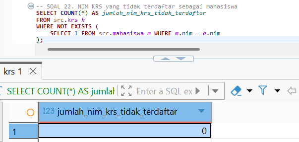


| krs_nim_tidak_terdaftar |
|---:|
| 0 |

**Interpretasi**

Hasilnya **0**: seluruh NIM pada tabel KRS memiliki pasangan pada tabel referensi. Tidak ditemukan record yatim (orphan) sehingga join aman. Integritas referensial pada relasi ini terpenuhi pada pemeriksaan ini.

## 6.2 Soal 23 — NIM nilai tidak terdaftar di mahasiswa

**Tujuan pemeriksaan**  
Menghitung record yang NIM pada tabel nilai tidak ditemukan pada tabel referensinya.

**Query SQL**

```sql
SELECT COUNT(*) AS nim_tidak_terdaftar
FROM src.nilai n
LEFT JOIN src.mahasiswa m ON n.nim = m.nim
WHERE m.nim IS NULL;
```

**Hasil eksekusi**

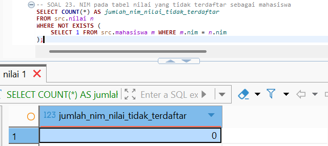


| nim_tidak_terdaftar |
|---:|
| 0 |

**Interpretasi**

Hasilnya **0**: seluruh NIM pada tabel nilai memiliki pasangan pada tabel referensi. Tidak ditemukan record yatim (orphan) sehingga join aman. Integritas referensial pada relasi ini terpenuhi pada pemeriksaan ini.

## 6.3 Soal 24 — Kode MK nilai tidak ada di mata_kuliah

**Tujuan pemeriksaan**  
Menghitung record yang `kode_mk` pada tabel nilai tidak ditemukan pada tabel referensinya.

**Query SQL**

```sql
SELECT COUNT(*) AS orphan_nilai_mk
FROM src.nilai n
LEFT JOIN src.mata_kuliah mk ON n.kode_mk = mk.kode_mk
WHERE mk.kode_mk IS NULL;
```

**Hasil eksekusi**

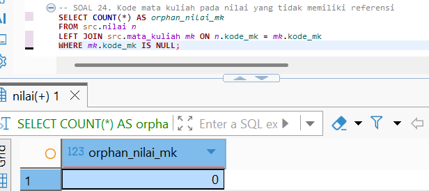


| orphan_nilai_mk |
|---:|
| 0 |

**Interpretasi**

Hasilnya **0**: seluruh `kode_mk` pada tabel nilai memiliki pasangan pada tabel referensi. Tidak ditemukan record yatim (orphan) sehingga join aman. Integritas referensial pada relasi ini terpenuhi pada pemeriksaan ini.

## 6.4 Soal 25 — Semester nilai tidak ada di semester

**Tujuan pemeriksaan**  
Menghitung record yang `semester_id` pada tabel nilai tidak ditemukan pada tabel referensinya.

**Query SQL**

```sql
SELECT COUNT(*) AS orphan_nilai_semester
FROM src.nilai n
LEFT JOIN src.semester s ON n.semester_id = s.semester_id
WHERE s.semester_id IS NULL;
```

**Hasil eksekusi**

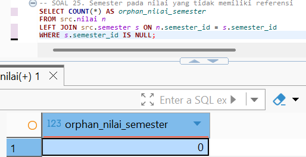


| orphan_nilai_semester |
|---:|
| 0 |

**Interpretasi**

Hasilnya **0**: seluruh `semester_id` pada tabel nilai memiliki pasangan pada tabel referensi. Tidak ditemukan record yatim (orphan) sehingga join aman. Integritas referensial pada relasi ini terpenuhi pada pemeriksaan ini.

---

# 7. Profiling Aktivitas LMS

## 7.1 Soal 26 — Duplikasi aktivitas LMS (lms_event_id)

**Tujuan pemeriksaan**  
Membandingkan jumlah seluruh record aktivitas LMS dengan jumlah `lms_event_id` unik.

**Query SQL**

```sql
SELECT
    COUNT(*)                          AS raw_rows,
    COUNT(DISTINCT lms_event_id)      AS distinct_event_id,
    COUNT(*) - COUNT(DISTINCT lms_event_id) AS duplicate_excess
FROM src.aktivitas_lms;
```

**Hasil eksekusi**

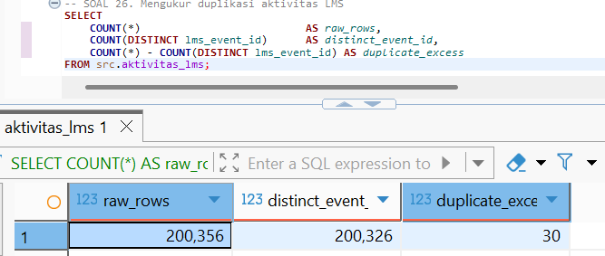


| Raw Rows | Distinct Event ID | Duplicate Excess |
|---:|---:|---:|
| 200.356 | 200.326 | 30 |

**Interpretasi**

Terdapat 30 record berlebih (0,015% dari total). Berdasarkan profiling lanjutan, ke-30 baris identik penuh sehingga terindikasi *exact duplicate* yang membuat jumlah event dan durasi belajar sedikit membengkak.

## 7.2 Soal 27 — Distribusi tipe aktivitas LMS

**Tujuan pemeriksaan**  
Menampilkan setiap `tipe_event` dan jumlah aktivitas pada masing-masing tipe.

**Query SQL**

```sql
SELECT
    tipe_event,
    COUNT(*) AS jumlah
FROM src.aktivitas_lms
GROUP BY tipe_event
ORDER BY jumlah DESC, tipe_event;
```

**Hasil eksekusi**

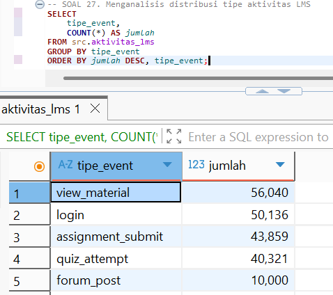


| tipe_event | jumlah |
|---|---:|
| view_material | 56.040 |
| login | 50.136 |
| assignment_submit | 43.859 |
| quiz_attempt | 40.321 |
| forum_post | 10.000 |

**Interpretasi**

Terdapat 5 tipe aktivitas. Paling banyak adalah `view_material` (56.040) dan paling sedikit `forum_post` (10.000). Tidak ditemukan variasi penulisan label tipe event. Komposisi menunjukkan mahasiswa lebih banyak membuka materi dan login dibandingkan berpartisipasi di forum.

## 7.3 Soal 28 — Skor kuis kosong pada quiz_attempt

**Tujuan pemeriksaan**  
Menghitung aktivitas `quiz_attempt` yang tidak memiliki skor pada `skor_kuis`.

**Query SQL**

```sql
SELECT COUNT(*) AS quiz_missing_score
FROM src.aktivitas_lms
WHERE tipe_event = 'quiz_attempt'
  AND (skor_kuis IS NULL OR TRIM(skor_kuis::text) = '');
```

**Hasil eksekusi**

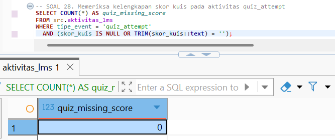


| Quiz Missing Score |
|---:|
| 0 |

**Interpretasi**

Hasilnya **0**: seluruh 40.321 aktivitas `quiz_attempt` memiliki skor kuis, sehingga analisis hasil kuis tidak terganggu oleh nilai kosong.

## 7.4 Soal 29 — Skor pada aktivitas selain kuis

**Tujuan pemeriksaan**  
Menghitung aktivitas selain `quiz_attempt` yang tetap memiliki nilai pada `skor_kuis`.

**Query SQL**

```sql
SELECT COUNT(*) AS nonquiz_with_score
FROM src.aktivitas_lms
WHERE tipe_event <> 'quiz_attempt'
  AND skor_kuis IS NOT NULL
  AND TRIM(skor_kuis::text) <> '';
```

**Hasil eksekusi**

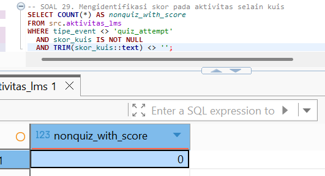


| Nonquiz With Score |
|---:|
| 0 |

**Interpretasi**

Hasilnya **0**. Hal ini konsisten dengan profiling kolom: `skor_kuis` kosong pada 160.035 record, yang sama dengan total aktivitas non-kuis (56.040 + 50.136 + 43.859 + 10.000). Jadi skor hanya terisi pada `quiz_attempt` sesuai rancangan.

---

# 8. Profiling Tabel Pembayaran

## 8.1 Soal 30 — Nominal pembayaran negatif

**Tujuan pemeriksaan**  
Menghitung record pembayaran dengan `nominal_bayar` kurang dari nol.

**Query SQL**

```sql
SELECT COUNT(*) AS negative_payment
FROM src.pembayaran
WHERE nominal_bayar < 0;
```

**Hasil eksekusi**

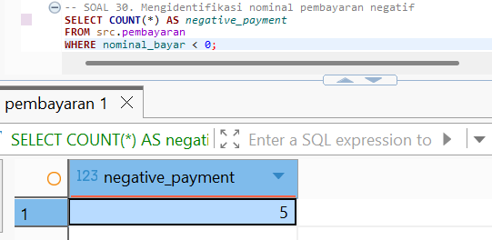


| Negative Payment |
|---:|
| 5 |

**Interpretasi**

Ditemukan **5 record** bernominal negatif (nilai minimum −5.750.000), semuanya berstatus Lunas. Contoh: `PAY0001112` (tagihan 5.750.000, bayar −5.750.000). Transaksi ini perlu ditelusuri sesuai konteks pencatatan keuangan (apakah koreksi/refund atau kesalahan input) karena dapat membuat total pembayaran dan piutang salah hitung.

## 8.2 Soal 31 — Pembayaran positif tanpa tanggal bayar

**Tujuan pemeriksaan**  
Menghitung pembayaran bernominal positif tetapi `tanggal_bayar_raw` kosong.

**Query SQL**

```sql
SELECT COUNT(*) AS positive_payment_missing_date
FROM src.pembayaran
WHERE nominal_bayar > 0
  AND (tanggal_bayar_raw IS NULL OR TRIM(tanggal_bayar_raw) = '');
```

**Hasil eksekusi**

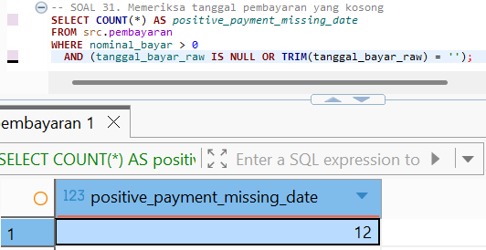


| Positive Payment Missing Date |
|---:|
| 12 |

**Interpretasi**

Terdapat **12 record** (10 berstatus Lunas dan 2 Cicilan) tanpa tanggal pembayaran. Total tanggal kosong pada tabel ini 473, dengan 461 di antaranya berstatus Belum Lunas sehingga wajar kosong. Ke-12 record ini mengganggu analisis ketepatan waktu pembayaran dan perlu dikonfirmasi ke sumber data.

## 8.3 Soal 32 — Distribusi status pembayaran

**Tujuan pemeriksaan**  
Menampilkan jumlah record berdasarkan setiap nilai `status_pembayaran`.

**Query SQL**

```sql
SELECT
    status_pembayaran,
    COUNT(*) AS jumlah
FROM src.pembayaran
GROUP BY status_pembayaran
ORDER BY jumlah DESC, status_pembayaran;
```

**Hasil eksekusi**

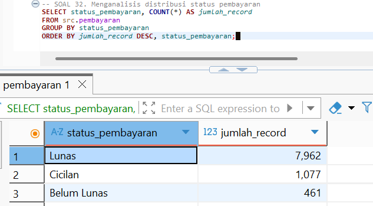


**Interpretasi**

Mayoritas transaksi berstatus Lunas (7.962 dari 9.500, sekitar 83,8%), diikuti Cicilan (1.077) dan Belum Lunas (461). Tidak ditemukan variasi penulisan label status.

---

# 9. Profiling Tabel Kelulusan

## 9.1 Soal 33 — Duplikasi data kelulusan

**Tujuan pemeriksaan**  
Membandingkan jumlah seluruh record kelulusan dengan jumlah NIM unik.

**Query SQL**

```sql
SELECT
    COUNT(*)                         AS raw_rows,
    COUNT(DISTINCT nim)              AS distinct_graduate_nim,
    COUNT(*) - COUNT(DISTINCT nim)   AS duplicate_excess
FROM src.kelulusan;
```

**Hasil eksekusi**

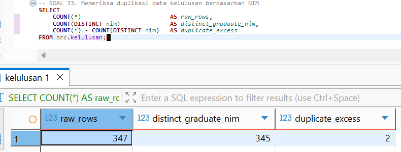


| Raw Rows | Distinct Graduate NIM | Duplicate Excess |
|---:|---:|---:|
| 347 | 345 | 2 |

**Interpretasi**

Ada 2 NIM yang tercatat dua kali (contoh: `21SI0036` dan `21BD0005`); kedua baris identik penuh sehingga terindikasi duplikat persis. Konteks bisnis juga mendukung: satu mahasiswa seharusnya hanya lulus satu kali. Duplikasi ini dapat membuat jumlah lulusan dan rata-rata IPK bias.

## 9.2 Soal 34 — Status kelulusan tepat waktu

**Tujuan pemeriksaan**  
Menampilkan jumlah record berdasarkan setiap nilai `status_tepat_waktu`.

**Query SQL**

```sql
SELECT
    status_tepat_waktu,
    COUNT(*) AS jumlah
FROM src.kelulusan
GROUP BY status_tepat_waktu
ORDER BY jumlah DESC, status_tepat_waktu;
```

**Hasil eksekusi**

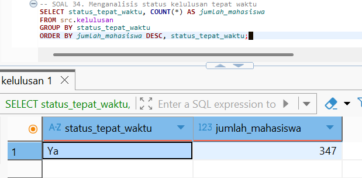


| status_tepat_waktu | jumlah |
|---|---:|
| Ya | 347 |

**Interpretasi**

Seluruh 347 record kelulusan berstatus `Ya` (tepat waktu); tidak ada kategori tidak tepat waktu. Setelah dikurangi 2 baris duplikat (Soal 33), 345 mahasiswa unik semuanya tercatat tepat waktu (100%). Catatan pendukung: seluruh lulusan berasal dari angkatan 2021 dengan masa studi 46–47 bulan (308 orang 46 bulan, 39 orang 47 bulan). Karena hanya ada satu kategori, perbandingan tepat waktu vs tidak tepat waktu belum dapat dilakukan; hal ini perlu dikonfirmasi apakah mahasiswa terlambat memang belum lulus atau datanya tidak tercatat.

---

# 10. Pemeriksaan Relasi Antar-Tabel

## 10.1 Soal 35 — Aktivitas LMS dengan NIM tidak terdaftar

**Tujuan pemeriksaan**  
Menghitung record yang NIM pada aktivitas LMS tidak ditemukan pada tabel referensinya.

**Query SQL**

```sql
SELECT COUNT(*) AS orphan_lms_student
FROM src.aktivitas_lms a
LEFT JOIN src.mahasiswa m ON a.nim = m.nim
WHERE m.nim IS NULL;
```

**Hasil eksekusi**

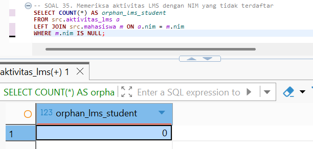


| orphan_lms_student |
|---:|
| 0 |

**Interpretasi**

Hasilnya **0**: seluruh NIM pada aktivitas LMS dapat dihubungkan dengan tabel induknya. Tidak ada orphan, sehingga relasi ini aman digunakan untuk join pada tahap berikutnya.

## 10.2 Soal 36 — Aktivitas LMS dengan kode MK tidak terdaftar

**Tujuan pemeriksaan**  
Menghitung record yang `kode_mk` pada aktivitas LMS tidak ditemukan pada tabel referensinya.

**Query SQL**

```sql
SELECT COUNT(*) AS orphan_lms_course
FROM src.aktivitas_lms a
LEFT JOIN src.mata_kuliah mk ON a.kode_mk = mk.kode_mk
WHERE mk.kode_mk IS NULL;
```

**Hasil eksekusi**

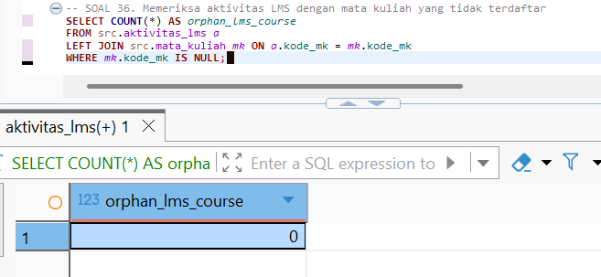


| orphan_lms_course |
|---:|
| 0 |

**Interpretasi**

Hasilnya **0**: seluruh `kode_mk` pada aktivitas LMS dapat dihubungkan dengan tabel induknya. Tidak ada orphan, sehingga relasi ini aman digunakan untuk join pada tahap berikutnya.

## 10.3 Soal 37 — Pembayaran dengan NIM tidak terdaftar

**Tujuan pemeriksaan**  
Menghitung record yang NIM pada pembayaran tidak ditemukan pada tabel referensinya.

**Query SQL**

```sql
SELECT COUNT(*) AS orphan_payment_student
FROM src.pembayaran p
LEFT JOIN src.mahasiswa m ON p.nim = m.nim
WHERE m.nim IS NULL;
```

**Hasil eksekusi**

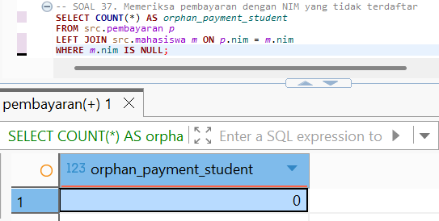


| orphan_payment_student |
|---:|
| 0 |

**Interpretasi**

Hasilnya **0**: seluruh NIM pada pembayaran dapat dihubungkan dengan tabel induknya. Tidak ada orphan, sehingga relasi ini aman digunakan untuk join pada tahap berikutnya.

## 10.4 Soal 38 — Kelulusan dengan NIM tidak terdaftar

**Tujuan pemeriksaan**  
Menghitung record yang NIM pada kelulusan tidak ditemukan pada tabel referensinya.

**Query SQL**

```sql
SELECT COUNT(*) AS orphan_graduation_student
FROM src.kelulusan k
LEFT JOIN src.mahasiswa m ON k.nim = m.nim
WHERE m.nim IS NULL;
```

**Hasil eksekusi**

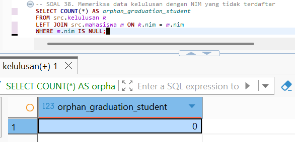


| orphan_graduation_student |
|---:|
| 0 |

**Interpretasi**

Hasilnya **0**: seluruh NIM pada kelulusan dapat dihubungkan dengan tabel induknya. Tidak ada orphan, sehingga relasi ini aman digunakan untuk join pada tahap berikutnya.

---

---

# 11. Rekapitulasi Hasil Data Profiling dan Data Quality

| No. | Area Pemeriksaan | Indikator | Hasil | Status | Catatan Temuan |
|---:|---|---|---:|---|---|
| 1 | Dataset | Jumlah record setiap tabel | 10 tabel; terbesar `aktivitas_lms` 200.356 | Tidak ditemukan masalah | Tabel transaksi jauh lebih besar dari master/referensi |
| 2 | Dataset | Jumlah kolom setiap tabel | 5–11 kolom | Tidak ditemukan masalah | Struktur sesuai definisi source |
| 3 | Mahasiswa | Kelebihan record berdasarkan NIM | 15 | Perlu pemeriksaan | 1.965 baris vs 1.950 NIM unik; duplikat persis |
| 4 | Mahasiswa | Kelompok NIM duplikat | 15 | Perlu pemeriksaan | Masing-masing muncul 2 kali |
| 5 | Mahasiswa | Kota asal kosong | 30 (1,53%) | Perlu pemeriksaan | Sebaran wilayah tidak lengkap |
| 6 | Mahasiswa | Variasi label program studi | 30 label (6 resmi) | Perlu pemeriksaan | 24 label non-canonical; perlu mapping |
| 7 | Mahasiswa | Variasi label jenis kelamin | 6 label (2 konsep) | Perlu pemeriksaan | L, P, Laki-laki, Perempuan, M, F |
| 8 | Mahasiswa | Program studi tidak cocok dengan referensi | 435 (22,1%) | Perlu pemeriksaan | Singkatan, kapitalisasi, penulisan lain |
| 9 | Mahasiswa | Variasi format tanggal masuk | 3 format; OTHER 0 | Perlu pemeriksaan | 1.429 / 346 / 190 record |
| 10 | KRS | Kelebihan record berdasarkan KRS ID | 25 | Perlu pemeriksaan | 57.025 baris vs 57.000 `krs_id` unik |
| 11 | KRS | Duplikasi kombinasi NIM–MK–semester | 25 kombinasi | Perlu pemeriksaan | Identik penuh; muncul 2 kali |
| 12 | Nilai | Nilai angka kosong | 20 | Perlu pemeriksaan | `nilai_huruf` juga kosong pada baris yang sama |
| 13 | Nilai | Nilai angka di luar rentang | 12 | Perlu pemeriksaan | 6 negatif, 6 > 100 |
| 14 | Nilai | Statistik nilai valid | 56.968 valid; min 34,8; maks 100,0; rata-rata 77,40 | Tidak ditemukan masalah | Deskriptif; rentang valid 0–100 |
| 15 | Nilai | Ketidaksesuaian nilai angka dan huruf | 20 | Perlu pemeriksaan | Skala konversi pada soal |
| 16 | Nilai | Ketidaksesuaian nilai dan status lulus | 0 | Tidak ditemukan masalah | Berbasis nilai angka valid; pembanding huruf vs status = 17 |
| 17 | Nilai | Duplikasi kombinasi NIM–MK–semester | 0 | Tidak ditemukan masalah | Key unik |
| 18 | Referential integrity | NIM KRS tidak terdaftar | 0 | Tidak ditemukan masalah | Relasi aman |
| 19 | Referential integrity | NIM nilai tidak terdaftar | 0 | Tidak ditemukan masalah | Relasi aman |
| 20 | Referential integrity | Kode MK nilai tidak terdaftar | 0 | Tidak ditemukan masalah | Relasi aman |
| 21 | Referential integrity | Semester nilai tidak terdaftar | 0 | Tidak ditemukan masalah | Relasi aman |
| 22 | LMS | Kelebihan record berdasarkan event ID | 30 | Perlu pemeriksaan | 200.356 vs 200.326 unik; duplikat persis |
| 23 | LMS | Distribusi tipe aktivitas | 5 tipe | Tidak ditemukan masalah | Label bersih |
| 24 | LMS | Skor kuis kosong | 0 | Tidak ditemukan masalah | Seluruh `quiz_attempt` memiliki skor |
| 25 | LMS | Skor pada aktivitas non-kuis | 0 | Tidak ditemukan masalah | Sesuai rancangan |
| 26 | Pembayaran | Nominal pembayaran negatif | 5 | Perlu pemeriksaan | Semua berstatus Lunas |
| 27 | Pembayaran | Pembayaran positif tanpa tanggal | 12 | Perlu pemeriksaan | 10 Lunas + 2 Cicilan |
| 28 | Pembayaran | Distribusi status pembayaran | 3 status | Tidak ditemukan masalah | Lunas 7.962; Cicilan 1.077; Belum Lunas 461 |
| 29 | Kelulusan | Kelebihan record berdasarkan NIM | 2 | Perlu pemeriksaan | 347 baris vs 345 NIM unik |
| 30 | Kelulusan | Distribusi status tepat waktu | Ya = 347; kategori lain = 0 | Perlu pemeriksaan | Hanya satu kategori; perbandingan tepat vs terlambat belum bisa dilakukan |
| 31 | Relasi LMS | NIM aktivitas LMS tidak terdaftar | 0 | Tidak ditemukan masalah | Relasi aman |
| 32 | Relasi LMS | Kode MK aktivitas LMS tidak terdaftar | 0 | Tidak ditemukan masalah | Relasi aman |
| 33 | Relasi pembayaran | NIM pembayaran tidak terdaftar | 0 | Tidak ditemukan masalah | Relasi aman |
| 34 | Relasi kelulusan | NIM kelulusan tidak terdaftar | 0 | Tidak ditemukan masalah | Relasi aman |

---

**Catatan validasi:** angka pada tabel hasil dan interpretasi harus sama dengan keluaran query yang benar-benar dijalankan pada database praktikum. Jika hasil aktual berbeda, perbarui angka dan interpretasi terkait; jangan mempertahankan angka contoh.

# 12. Kesimpulan Praktikum

1. **Gambaran umum struktur dan ukuran dataset.**
   Dataset akademik terdiri atas 10 tabel dengan 5–11 kolom per tabel. Tabel transaksi mendominasi ukuran data (`aktivitas_lms` 200.356, `krs` 57.025, `nilai` 57.000 record), sedangkan tabel referensi sangat kecil (`program_studi` 6, `semester` 8).

2. **Aspek kualitas data yang menunjukkan indikasi masalah.**
   *Uniqueness* (duplikat pada `mahasiswa`, `krs`, `aktivitas_lms`, `kelulusan`), *completeness* (kota asal, nilai angka, tanggal bayar), *validity* (nilai di luar 0–100, nominal pembayaran negatif), dan *consistency* (label program studi, jenis kelamin, status, serta format tanggal yang bervariasi; huruf mutu tidak selalu sesuai nilai angka).

3. **Tabel dengan temuan paling banyak.**
   Tabel `mahasiswa` paling banyak temuan karena memuat duplikasi NIM, kota kosong, serta variasi label dan format tanggal. Tabel `nilai` juga perlu perhatian karena menyentuh ukuran utama analisis (nilai kosong, di luar rentang, dan tidak sesuai huruf).

4. **Relasi antar-tabel yang tidak terpenuhi.**
   Tidak ada. Seluruh pemeriksaan orphan (Soal 22–25 dan 35–38) bernilai 0, sehingga relasi aman digunakan untuk join pada tahap berikutnya.

5. **Pemeriksaan lanjutan sebelum cleaning, standardisasi, atau deduplikasi.**
   Konfirmasi skala resmi konversi nilai pada data dictionary, verifikasi kolom otoritatif antara nilai angka, huruf, dan status lulus, pemeriksaan apakah baris duplikat identik penuh atau data historis, penentuan aturan penanganan nilai kosong dan nominal negatif, serta penyusunan tabel mapping label dan aturan parsing tanggal multi-format.

## 12.1 Temuan Utama

1. Terdapat duplikat persis pada empat tabel (mahasiswa 15, KRS 25, LMS 30, kelulusan 2 baris berlebih; total 72) yang berisiko menyebabkan *double counting*.
2. Label kategori pada mahasiswa tidak seragam: 30 label untuk 6 program studi (435 record, 22,1%) dan 6 label untuk 2 jenis kelamin (437 record, 22,2%).
3. Tiga format tanggal (`YYYY-MM-DD`, `DD/MM/YYYY`, `DD-Mon-YYYY`) digunakan bersamaan; sekitar 27% record pada `tanggal_masuk_raw` bukan format ISO.
4. Tabel `nilai` memuat 20 nilai kosong, 12 nilai di luar rentang 0–100, dan 20 ketidaksesuaian nilai angka dengan huruf; tabel `pembayaran` memuat 5 nominal negatif dan 12 transaksi positif tanpa tanggal.
5. Integritas referensial antar-tabel bersih (0 orphan pada seluruh relasi yang diuji), dan seluruh lulusan (347 record, 345 mahasiswa unik) berstatus tepat waktu sehingga tidak ada pembanding mahasiswa terlambat.

## 12.2 Rekomendasi Pemeriksaan Lanjutan

1. Konfirmasi ke pemilik data (dosen/bagian akademik) skala konversi nilai resmi dan kolom otoritatif untuk nilai angka, huruf, dan status lulus.
2. Verifikasi seluruh baris duplikat (mahasiswa, KRS, LMS, kelulusan) terhadap atribut lain untuk memastikan tidak ada data historis sebelum merancang aturan deduplikasi di staging.
3. Susun tabel mapping label (program studi, jenis kelamin, status) dan satu aturan parsing multi-format tanggal untuk tahap transformasi, serta konfirmasi ke bagian keuangan atas 5 nominal negatif dan 12 tanggal bayar kosong.
